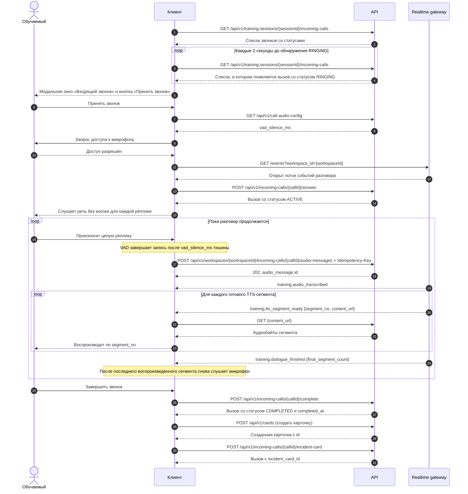

# Входящие учебные звонки

Список звонков сессии:

```http
GET /api/v1/training-sessions/{sessionId}/incoming-calls
X-User-Id: <student-uuid>
```

Текст и ссылки на аудио конкретного звонка:

```http
GET /api/v1/training-calls/{callId}/transcript
X-User-Id: <user-uuid>
```

Ответ содержит `call_id`, `training_session_id`, `answered_at`, `completed_at`
и `utterances[]` в порядке `sequence_no`. У каждой реплики есть `id`, `speaker`
(`OPERATOR`, `CALLER` или `RESPONSE_LEAD`), `input_mode` (`VOICE`, `TEXT` или
`GENERATED`), `created_at`, `text` и `audio_urls[]`. Для `VOICE` список обычно
содержит исходную запись; для `GENERATED` — отдельные TTS-сегменты по порядку.
Пустой список означает, что готового аудио нет. `created_at` — время записи
сообщения сервером, не момент воспроизведения. `call_payload.initial_utterance`
служит контекстом модели и не выдаётся как фактически произнесённая реплика.

Обучаемый получает расшифровку своего звонка, преподаватель — звонка своего
назначения. Пока обязательная авторизация отключена, идентификатор передаётся
в `X-User-Id`; при включённой авторизации он должен совпадать с JWT.

После срабатывания триггера звонок переходит из `PENDING` в `RINGING`.
Текущий клиент узнаёт об этом через REST-опрос списка: при открытии экрана и
затем каждые 2 секунды. Отдельного SSE-события о поступлении звонка сейчас нет.
Действия со звонком и его аудиосообщениями доступны только участнику с ролью
`OPERATOR_112` (`position_code: null`). Участник ДДС работает с карточками
назначенной ему службы.

После обнаружения звонка клиент вызывает методы по ходу сценария:

```http
POST /api/v1/incoming-calls/{callId}/answer
{"user_id":"student-uuid"}

POST /api/v1/incoming-calls/{callId}/complete
{"user_id":"student-uuid"}

POST /api/v1/cards
{"workspace_id":"workspace-uuid","operator_id":"student-uuid","classification":{"record_id":1050101,"group_code":1,"feature_1_code":5,"feature_2_code":1,"feature_3_code":1,"final_incident_type":"пожар: квартира","routing_flags":{},"excluded_service_codes":[]},"applicant_full_name":"Иванов Иван Иванович"}

POST /api/v1/incoming-calls/{callId}/incident-card
{"user_id":"student-uuid","incident_card_id":"created-card-uuid"}
```

Карточка создаётся существующим `POST /api/v1/cards` в workspace текущей
сессии с `operator_id`, равным `user_id` отвечающего обучаемого, а затем
привязывается ко звонку. `POST /complete` фиксирует `completed_at` на сервере
при завершении разговора; карточку можно создать и привязать после этого.
Пока карточка не привязана, завершение учебной сессии блокируется. Уже
выпущенную сценарную карточку использовать вместо созданной оператором нельзя.
ФИО заявителя сохраняется в необязательном поле карточки
`applicant_full_name` (до 255 символов).

Полный цикл статусов: `PENDING → RINGING → ACTIVE → COMPLETED`. Незавершённый,
ошибочный или отменённый звонок блокирует завершение сессии. При итоговой оценке
`expected_result.card` сравнивается с привязанной итоговой карточкой, включая
`questionnaire`, если это поле задано в шаблоне. Содержание разговора и перечень
заданных вопросов отдельно не оцениваются: call-scoped STT/TTS через
`audio_message.training_call_id` нужны для воспроизведения диалога и ожидания
окончания обработки речи.

Для шкалы разговора используйте
`GET /api/v1/training-calls/{callId}/transcript` с `X-User-Id`.
Ответ уже содержит `answered_at` и `completed_at`; в `utterances[]` есть
`created_at`, `audio_urls[]` и `duration_ms`. Для новых голосовых сообщений
длительность определяется при обработке аудио; у старых WAV она читается из
заголовка. Для старых записей других форматов или недоступного файла значение
может быть `null`.
`audio_urls[]` ссылается на отдельные реплики или TTS-сегменты.

## Единая запись звонка

После `POST /api/v1/incoming-calls/{callId}/complete` сервер ставит сборку записи
в очередь. Она начинается после готовности всех аудиореплик и TTS-сегментов.
Аудио склеивается по `sequence_no`, внутри ответа модели — по `segment_no`, без
восстановления пауз и фактического времени воспроизведения.

```http
GET /api/v1/training-calls/{callId}/recording
X-User-Id: <user-uuid>
```

Ответ содержит `call_id`, `status` (`QUEUED`, `PROCESSING`, `READY` или `FAILED`),
`content_type`, `duration_ms`, `size_bytes`, `completed_at`, `content_url` и
`last_error`. До `READY` поля файла и `content_url` равны `null`. При `FAILED`
сборка не создала файл; frontend показывает ошибку. Доступ разрешён оператору
этого звонка и преподавателю его назначения. При включённом JWT заголовок
`X-User-Id` должен совпадать с токеном.

Когда `status=READY`, аудио `audio/mpeg` доступно по `content_url`:

```http
GET /api/v1/training-calls/{callId}/recording/content
X-User-Id: <user-uuid>
Range: bytes=0-
```

Без `Range` ответ `200` с полным MP3; с допустимым одиночным диапазоном —
`206 Partial Content`. Если запись ещё готовится, контент возвращает `409`.
Для вызова до завершения звонка оба метода возвращают `409`.
`call_payload.initial_utterance` — только промпт модели, поэтому в запись не
попадает. Старые завершённые звонки ставятся в очередь миграцией `0019`.
Размер готового файла ограничен действующим `S112_AUDIO_MAX_UPLOAD_BYTES`;
при превышении сборка завершится статусом `FAILED`.

## Разговор после принятия звонка

Клиент запрашивает `GET /api/v1/call-audio-config` и использует
`vad_silence_ms` (по умолчанию 600 мс) для автоматического завершения реплики.
Значение задаётся через `S112_CALL_VAD_SILENCE_MS` в `backend/.env`.
Микрофон записывает целую реплику; клиент отправляет её в
`POST /api/v1/workspaces/{workspaceId}/incoming-calls/{callId}/audio-messages`
с постоянным `Idempotency-Key` при повторных попытках. Следующую реплику
клиент начинает записывать после окончания воспроизведения всех сегментов
ответа собеседника.

После STT `dialogue-worker` первым сообщением передаёт LLM системный промпт с
ролью заявителя и полным эталонным контекстом из `expected_result.card`.
`call_payload.initial_utterance` добавляется в историю как первая реплика
заявителя, после неё передаётся история разговора, включая текущий вопрос
оператора. Поток LLM разбивается на короткие фразы: первые две выделяются
раньше последующих. Каждая фраза
сохраняется в `tts_segment` вместе с outbox-заданием для TTS. После сохранения
аудио в SeaweedFS результат проходит через result-outbox и Kafka; SSE-событие
`training.tts_segment_ready` содержит `segment_no` и `content_url`.
Аудиобайты клиент получает по авторизованному
`GET /api/v1/tts-segments/{segmentId}/content`. Полный список для восстановления
после разрыва SSE: `GET /api/v1/audio-messages/{messageId}/tts-segments`.
Событие `training.dialogue_finished` сообщает итоговое число сегментов.
После привязки карточки её список аудиосообщений включает и ранее записанные
реплики этого звонка.

## Взаимодействие клиента с сервером

Схема ниже описывает только публичные HTTP/SSE-вызовы, которые нужны
фронтенду. Внутренние очереди, воркеры и хранилища здесь не показаны.



Для обнаружения звонка клиент передаёт `X-User-Id` в запросе списка, выбирает
свой `workspace_id` и звонок в состоянии `RINGING`. Если экран перезагружен во
время разговора, тот же список позволяет найти свой `ACTIVE`-звонок по
`operator_user_id` и предложить продолжение. Текущая задержка появления
модального окна — до интервала опроса (2 секунды) плюс время ответа API. Само
по себе SSE-подключение не сообщает о новом входящем звонке.

Для действий со звонком в JSON передаётся `user_id`; для загрузки речи нужны
`X-User-Id`, `Idempotency-Key` и `multipart/form-data` с полем `audio`.
Повторная отправка той же реплики использует тот же ключ идемпотентности.
Клиент загружает сегменты по `content_url` через API, а не из SSE, и
воспроизводит их по `segment_no`. После `training.dialogue_finished` он ждёт
воспроизведения всех `final_segment_count` сегментов, затем снова включает
прослушивание. `training.dialogue_finished` и готовые сегменты могут прийти в
разном порядке; счётчик сегментов определяет конец ответа. При ошибке STT,
TTS или генерации приходят `training.audio_processing_failed`,
`training.tts_segment_failed` или `training.dialogue_failed`. При разрыве SSE
или `stream.gap` состояние восстанавливается
через `GET /api/v1/workspaces/{workspaceId}/incoming-calls/{callId}/audio-messages`
и `GET /api/v1/audio-messages/{messageId}/tts-segments`. Базовые URL API и
SSE задаются отдельно (`VITE_BACKEND_API_BASE_URL`, `VITE_REALTIME_BASE_URL`).

Для локального интерфейса скопируйте `frontend/.env.example` в `frontend/.env`
и задайте идентификаторы учебной сессии, workspace и Обучаемого. При наличии
`VITE_TRAINING_SESSION_ID` frontend переключается на окно входящего звонка.
LLM задаётся в `backend/.env`: `S112_DIALOGUE_LLM_BASE_URL` (OpenAI-совместимый
`/v1` endpoint), `S112_DIALOGUE_LLM_MODEL`, при необходимости
`S112_DIALOGUE_LLM_API_KEY`. Модель LLM должна быть доступна для
`dialogue-worker`. Изменение переменных Vite требует перезапуска frontend,
а переменных Compose — пересоздания соответствующих контейнеров.
