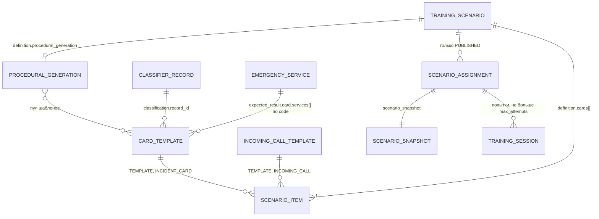

# Конструктор сценариев и шаблонов

Статус: черновик, разведка и проектирование; кода нет
Потребитель на фронте: `pages/teacher-scenarios` (список), `pages/teacher-scenario-card` (карточка),
будущие редактор сценария, список и редактор шаблонов
Связанные файлы фронта: `frontend/src/entities/scenario/*`,
`frontend/src/shared/api/contracts/training-scenarios.ts`,
`frontend/src/entities/incident/model/classifier.ts` (каскад признаков и список служб по ЕКП),
`docs/api/scenarios.md`

Разведка сделана по коду бэкенда, README использовались только для сверки:
`backend/src/s112/api/teacher/training_content/api.py`, `api/simulation_schemas.py`,
`api/simulation_service.py` (`create_template`, `create_scenario`, `update_scenario`,
`delete_scenario`, `_validate_template_content`, `_validate_template_references`,
`_procedural_templates`, `create_assignment`, `_evaluate_card`, `_compare_expected`, `_card_state`),
`api/schemas.py`, `classifier_reference.py`, `scenario_worker/worker.py`, `dialogue/worker.py`,
`speech_worker/request_worker.py`, `common/config.py`.

## Назначение

Преподаватель готовит учебный материал. Сценарий — набор карточек и звонков, по которым обучаемый
работает в АРМ. У каждого элемента есть эталон `expected_result`: с ним сервер сравнивает итоговую
карточку и действия обучаемого. Конструктор эталона — это конструктор критериев оценки, а для
звонка ещё и «память» виртуального заявителя (см. «Эталон — это и знания заявителя»).

Без конструктора сценарии заводятся только запросами к API вручную: преподаватель не может
подготовить занятие сам, а путь ТЗ «Настройка учебной среды» не выполняется.

## Материалы заказчика

Лежат в `docs/reference-ui/` (папка не коммитится):

| Материал | Есть | Что из него взято |
|---|---|---|
| ТЗ (`ТЗ.docx`) | да | требования роли «Преподаватель» и путь «Настройка учебной среды», см. ниже |
| Билеты (`Билеты.docx`) | да | 32 билета по 3 вызова: 96 вызовов, 94 уникальных |
| Классификатор v046_11 (`…_v_046_11_ДТУ_15_11_2024_искл_пожар_задымление.xlsx`) | да | по нему в JSON бэкенда заполнен только сценарий реагирования |
| Классификатор v046_24 (`…_v_046_24_корректировка_МВД_+_Департамент.xlsx`) | **нет** | именно из него бэкенд собрал классификацию и маршрутизацию служб (`incident_classifier_reference.json`, поле `sources`). Нужен для сверки справочника и библиотеки |
| Инструкция по заведению карточки (`Инструкция_по_заведению_карточки_2507ГСИ.docx`) | да | правила заполнения полей карточки, пригодятся для подсказок в редакторе эталона |
| Памятка АРМ-112 для ДДС (`Работа на АРМ-112 — памятка для ДДС.docx`) | да | статусы реагирования, уже в `docs/domain/response-status.md` |
| Руководство пользователя, скриншоты АРМ-112 и ДДС | да | для предпросмотра «как увидит обучаемый» |
| Вопросы и ответы заказчика (сложность 4 уровня или вес 1–10; тайминг 30 с и 3 мин; утверждение с возможностью снять) | в репозитории нет | взяты из постановки задачи. Если есть документ — положить рядом, чтобы ссылаться на первоисточник |

## Требования заказчика и что им отвечает бэкенд

| Требование | ТЗ / Q&A | На бэкенде сейчас | Разрыв |
|---|---|---|---|
| Создавать, редактировать, удалять сценарии | ТЗ, роль «Преподаватель» | POST, PATCH (только черновик), DELETE = архив | правка утверждённого — только через копию, которой нет |
| Утверждать сценарии, в том числе сгенерированные ИИ; к обучаемым попадает только утверждённое | ТЗ | `DRAFT → PUBLISHED` через PATCH; назначить можно только `PUBLISHED` | «утверждено» = `PUBLISHED`, есть |
| Снять утверждение | Q&A | `PUBLISHED → DRAFT` запрещено: PATCH опубликованного — 409 | **нет** |
| Подтверждать эталон частично или полностью | ТЗ, путь «Настройка учебной среды» | признака подтверждения у поля или элемента нет | **нет** |
| Генерация сценария и эталона ИИ по категории событий | ТЗ | генерации нет; LLM есть только для диалога и смысловой проверки исходящего звонка | **нет** |
| Коррекция сгенерированного через комментарий | ТЗ | нет | **нет** |
| Параметры: тип происшествия, локация, сложность | ТЗ | тип — у элементов (классификация); локации как параметра нет, адрес — свободный текст в карточке; сложность 1–5 | локации нет; шкала сложности не совпадает с 4 уровнями или весом 1–10 |
| Тайминг (по умолчанию 30 с на реакцию, 3 мин на обработку) | ТЗ, Q&A | константы бэкенда `CARD_OPEN_DEADLINE_SECONDS = 30`, `CARD_DECISION_DEADLINE_SECONDS = 180`, в сценарии не задаются | ТЗ говорит «устанавливать», а `docs/domain/time-norms.md` — «фиксированы»; нужно решение |
| Критерии успешности: пороги ошибок, требования к синтаксису и грамматике, особенно адресов | ТЗ, Q&A | `passed` = ноль расхождений; порогов нет; грамматика не проверяется (C6 без путей расхождений) | **нет** |
| Проверка грамматики после ручных правок | ТЗ | нет | **нет** |
| Предпросмотр «как увидит обучаемый» с подсветкой правильного | ТЗ | данных достаточно (`initial_card`, эталон), ручка не нужна | фронт |
| Классифицировать задания по сложности | ТЗ | `difficulty` у шаблонов и сценариев | есть |
| Не менять сценарий во время активного занятия; изменения не ломают пройденные попытки | ТЗ, Q&A | правится только черновик, назначение хранит снимок | есть по построению |
| Преподаватель не правит чужие сценарии | Q&A | `created_by` хранится, при правке не проверяется | **нет** |
| Профильные события в ленте обучаемого | ТЗ | позиция ДДС (`participant_positions`) фильтрует карточки по службе | есть |

## Карта сущностей

| Сущность | Где | Ключевое |
|---|---|---|
| Шаблон карточки `card_template` | `CardTemplateCreate` | `template_key` + `version`, `name`, `description`, `difficulty` 1–5, `initial_card` (`CardCreate`), `expected_result` (обязателен `card`), `is_active`, `created_by` |
| Шаблон входящего звонка `incoming_call_template` | `IncomingCallTemplateCreate` | то же, но `initial_call` (`initial_utterance`, `automatic_phone_number`) вместо `initial_card`; в `expected_result` запрещены `outbound_call` и `service_status_history` |
| Сценарий `training_scenario` | `TrainingScenarioCreate` | `name`, `description`, `difficulty`, `estimated_duration_seconds`, `workspace_mode`, `completion_policy`, `min/max_participants`, `definition`, `status`, `revision`, `created_by`, `updated_by` |
| Элемент сценария | `ScenarioCardDefinition` | `key`, `item_type` (`INCIDENT_CARD` / `INCOMING_CALL`), триггер, `source_type` (`TEMPLATE` / `INLINE`), `template_id` либо `initial_card` + `expected_result` |
| Процедурная подача | `ProceduralCardGeneration` | `target_count` 1–100, пул: `template_ids` и/или `classification_group_codes`; темп — от сложности (`docs/domain/time-norms.md`) |
| Назначение | `ScenarioAssignmentCreate` | участники, `participant_positions` (код службы ДДС или `null` для оператора 112), `incoming_call_operators`, политика запуска, окно, `max_attempts`; хранит снимок |
| Классификатор | `backend/src/s112/incident_classifier_reference.json` | 1283 записи, формат 2.0.0. Ключ записи — `classifier_number` = группа·10⁶ + п1·10⁴ + п2·10² + п3; поля: коды и названия трёх признаков, `final_incident_type`, `ekp35_incident_type`, `response_scenario`, `primary_service`, `routes`. **Ручки нет**; тот же файл лежит на фронте в `entities/incident/data/incident-classifier.json`, версии совпадают |
| Справочник служб | `GET /api/v1/services` | `id`, `code`, `name`, `notification_method`, `sort_order`, `is_active` |
| Адреса | — | справочника нет; в карточке `reported_address`, `incident_address` — свободный текст, `latitude`, `longitude` в `CardCreate` есть, в эталоне нет |

Роли элементов на практике: **входящий звонок — работа оператора 112**, он заводит карточку со слов
заявителя; **карточка `INCIDENT_CARD` — работа диспетчера ДДС**, карточка приходит заполненной и
маршрутизируется в службы. Поля «роль сценария» нет: роль участника задаёт назначение
(`participant_positions`).

## Ручки

### Есть на бэкенде

Все — card-api, префикс `/api/v1`, доступ `TEACHER` или `ADMINISTRATOR` (проверка роли по
`X-User-Id` или по полю автора в теле), `STUDENT` — 403.

| Метод | Путь | Тело / query | Ответ | Ошибки |
|---|---|---|---|---|
| POST | `/card-templates` | `template_key?`, `version`=1, `name`, `description?`, `difficulty`, `initial_card`, `expected_result`, `created_by` | 201 `CardTemplateResponse` | 409 такая версия есть; 422 схема, классификация не совпадает с записью, служба неизвестна или неактивна |
| GET | `/card-templates` | `active_only`=true, `X-User-Id` | 200 массив по имени, ключу, версии | 403 |
| GET | `/card-templates/{id}` | `X-User-Id` | 200 | 404 |
| DELETE | `/card-templates/{id}` | тело `{deleted_by}` | 204, на деле `is_active = false` | 409 используется неархивным сценарием или пулом процедурной подачи |
| POST GET | `/incoming-call-templates`, `/incoming-call-templates/{id}` | как у карточек, `initial_call` вместо `initial_card` | как у карточек | как у карточек |
| DELETE | `/incoming-call-templates/{id}` | `{deleted_by}` | 204, деактивация | 409 используется |
| POST | `/training-scenarios` | `TrainingScenarioCreate`, `status` по умолчанию `DRAFT`, `created_by` | 201 | 422 структура, ссылки на шаблоны, службы, пул |
| GET | `/training-scenarios` | `status`, `difficulty`, `include_archived`=false | 200 массив без `items` | 403 |
| GET | `/training-scenarios/{id}` | `X-User-Id` | 200: поля сценария + `items[]` (разрешённые шаблоны, `expected_card`, классификация, главная служба, список оповещения) | 404 |
| PATCH | `/training-scenarios/{id}` | `expected_revision`, `updated_by`, любые поля, `definition` целиком, `status` | 200, `revision + 1` | 409 ревизия; 409 «Only a draft scenario can be edited»; 422 `ARCHIVED` через PATCH, остальное как у POST |
| DELETE | `/training-scenarios/{id}` | `{deleted_by, expected_revision}` | 204, на деле `ARCHIVED` | 409 ревизия |
| GET | `/services` | — | справочник служб | — |

| Операция | Сценарий | Шаблон |
|---|---|---|
| Создание | есть | есть |
| Изменение | только черновик, PATCH целиком `definition` | нет; «правка» = новая версия: POST с тем же `template_key` и `version + 1` |
| Удаление | архив (DELETE), из любого статуса | деактивация, запрещена при использовании |
| Копирование | нет, только на клиенте GET → POST | нет, только на клиенте |
| Версии | `revision` растёт при каждой правке; истории ревизий нет | `version` у ключа; сценарий ссылается на конкретный `template_id`, новая версия сама не подхватывается |
| Статусы | `DRAFT`, `PUBLISHED`, `ARCHIVED` | `is_active` |
| Автор | `created_by`, `updated_by`; при правке не проверяется | `created_by`; не проверяется |

Изменения относительно прежних документов:
- ручек признаков 1–3 порядка и `GET /feature-schemas/resolve` в коде бэкенда больше нет; список
  во внутренних заметках по контракту в этой части устарел;
- `initial_call` в сценарии запрещён: `INCOMING_CALL` — только ссылка на шаблон звонка;
- поля `mode` со значениями `ARM112` / `DDS` из `docs/api/scenarios.md` нет. `definition.mode`
  означает другое: `STATIC` / `PROCEDURAL` / `HYBRID`.

### Нет на бэкенде, нужно для конструктора

| Приоритет | Ручка или поле | Зачем |
|---|---|---|
| P1 | `POST /training-scenarios/{id}/unpublish` или разрешить `PUBLISHED → DRAFT` в PATCH, если нет активных назначений | снять утверждение (Q&A) |
| P1 | Проверка владельца в PATCH и DELETE сценария и DELETE шаблона; администратору — только чтение | «не правит чужие сценарии» (Q&A) |
| P1 | Признак подтверждения эталона: `expected_result_review` у элемента или шаблона со статусом по полям (`confirmed` / `pending`) и запрет публикации с неподтверждёнными полями | частичное и полное подтверждение эталона (ТЗ) |
| P1 | `target_roles` и `used_in_assignments` в ответе списка сценариев | фильтры «роль 112 / ДДС» и «используется в занятиях» без обхода чужих назначений |
| P1 | Критерии успешности сценария: `pass_threshold` (доля или число допустимых расхождений) и, если решат, пороги по классам ошибок | «пороги допустимых ошибок» (ТЗ); сейчас зачёт — только ноль расхождений |
| P1 | Нормализованное сравнение текстовых полей (регистр, пробелы, пунктуация, «ул.» / «улица»), для описания — смысловое | «требования к синтаксису, особенно адресов» (ТЗ); сейчас посимвольно |
| P1 | Единая семантика `null` для `INLINE` и `TEMPLATE` и явное «не проверять» у поля | предсказуемая оценка независимо от источника элемента |
| P1 | Закрытый список `action_type` для `AFTER_ACTION` со справочником названий | выбор условия подачи из списка |
| P1 | `POST /scenario-drafts/generate` — генерация черновика по категории (группы классификатора), сложности и числу элементов; ответ — черновик сценария с `INLINE`-элементами и эталоном в статусе «не подтверждено» | генерация ИИ (ТЗ) |
| P2 | `POST /scenario-drafts/{id}/items/{key}/regenerate` с `comment` | коррекция сгенерированного комментарием (ТЗ) |
| P2 | Проверка грамматики текста (`POST /text-checks`) и путь расхождений для C6 | «проверка грамматики после ручных правок» (ТЗ) |
| P2 | `POST /training-scenarios/{id}/copy` с полем «копия от» | правка утверждённого без ручного копирования, связь версий |
| P2 | `POST /training-scenarios/validate` — те же правила без сохранения | проверка перед сохранением без черновиков-мусора |
| P2 | Сложность по шкале заказчика (4 уровня или вес 1–10) и `suggested_difficulty` от ИИ | параметр «сложность» из Q&A |
| P2 | Настройка тайминга у сценария, если заказчик подтвердит, что его меняет преподаватель | «устанавливать временные рамки» (ТЗ) |
| P2 | `voice_id` у шаблона звонка и справочник голосов из `models/refs` | выбор голоса заявителя |
| P2 | Версия классификатора (`GET /classifier/version` или заголовок) | обнаружение рассинхронизации справочника |
| P2 | Фильтры списков: `created_by`, `group_code`, `difficulty` у шаблонов; `created_by` у сценариев; число сценариев на шаблон | списки при сотнях материалов |
| P2 | Проверка позиции ДДС при назначении: хотя бы одна карточка маршрутизируется в эту службу | назначения, где диспетчер ничего не получит |

## Правила валидации

Сервер — источник истины. Клиент повторяет эти правила, чтобы показать ошибку у поля до
отправки, а 422 сервера раскладывает по `loc`.

### Сценарий

| Правило | Где |
|---|---|
| `name` 1–255, `difficulty` 1–5, `estimated_duration_seconds` > 0 | `TrainingScenarioCreate` |
| `INDIVIDUAL` ⇒ `min = max = 1`; `SHARED` ⇒ 1 ≤ min ≤ max ≤ 100 | там же, `_validate_participant_range` |
| `SHARED` ⇒ завершение `TEACHER_ONLY`; `INDIVIDUAL` ⇒ `STUDENT_CONFIRM` или `AUTO_WHEN_READY`; по умолчанию подставляется | `_resolve_completion_policy` |
| `STATIC`: хотя бы один элемент, без процедурной подачи; `PROCEDURAL`: без элементов, с подачей; `HYBRID`: и то и другое | `ScenarioDefinition` |
| Процедурная подача ⇒ `schema_version` ≥ 3; входящий звонок ⇒ `schema_version` ≥ 2 | там же |
| `key` элемента: `^[A-Za-z0-9_.-]+$`, до 100 символов, уникален, не начинается с `generated.<key>.` | там же |
| Триггер: `TIME_OFFSET {offset_seconds ≥ 0}` или `AFTER_ACTION {card_key, action_type, delay_seconds ≥ 0}`; `card_key` существует и не равен своему ключу; `MANUAL` отклоняется | `ScenarioCardDefinition` |
| `TEMPLATE`: есть `template_id`, нет `initial_card` и `expected_result`; шаблон активен | `ScenarioCardDefinition`, `_validate_template_references` |
| `INLINE`: только для `INCIDENT_CARD`; обязательны `initial_card` и `expected_result.card`; нет `template_id` | там же |
| `INCOMING_CALL`: без `initial_card`, в эталоне нет `outbound_call` и `service_status_history` | там же |
| Пул процедурной подачи: активные шаблоны сложностью не выше сценария, с классификацией в карточке и в эталоне; после фильтра по группам их не меньше `target_count` | `_procedural_templates` |

`action_type` в `AFTER_ACTION` — свободная строка. Опечатка даёт элемент, который никогда не
выйдет, а попытка из-за этого не сможет завершиться (`scenario_completion.py` ждёт выпуска всех
элементов).

### Для 112 и для ДДС

| | Оператор 112 | Диспетчер ДДС |
|---|---|---|
| Элемент | `INCOMING_CALL`, только из шаблона звонка | `INCIDENT_CARD`, из шаблона или `INLINE` |
| Что задаёт эталон | итоговая карточка: классификация, поля со слов заявителя, службы, статус карточки | исходная карточка (её не правят) + решение и цепочка статусов по службам + при необходимости исходящий звонок (`outbound_call`) |
| Запрещено в эталоне | `outbound_call`, `service_status_history` | — |
| Назначение | нужен участник без позиции; при нескольких операторах каждый звонок закрепляется | позиция — код активной службы, одна позиция на участника |
| Запуск | `INDIVIDUAL` — сам или преподаватель; `SHARED` — только преподаватель | то же |

### Эталон `expected_result`

| Блок | Поля и правила |
|---|---|
| `card` (обязателен у шаблонов и `INLINE`) | `classification` (обязательна и совпадает с записью классификатора по `group_code`, `feature_1..3_code`, `final_incident_type`), `description` (обязательна), `questionnaire {questions, answers}` или `null`, `applicant_full_name` ≤ 255, `automatic_phone_number`, `provided_phone_number`, `location_phone_number` ≤ 64, `reported_address`, `incident_address`, `victims_count` ≥ 0, `current_status` (7 статусов карточки), `services` (коды, уникальны, активны, не из `excluded_service_codes`), `service_statuses` (ровно по `services`) |
| `service_status_history` | по каждой службе из `services` — непустая цепочка от `ADDED` по автомату переходов (`docs/domain/response-status.md`); комментарий обязателен для `REJECTED` и `WORK_REFUSED`; последний статус равен `service_statuses[code]`; `unit_number` ≤ 64 хранится, но не оценивается |
| `outbound_call` | `expected_text` 1–10 000, `minimum_similarity` 0..1, по умолчанию 0.8; смысловое сравнение моделью |

`initial_card` — это `CardCreate`: `classification` обязательна; остальные поля совпадают с
эталоном, плюс `source_type` (`CALL`, `SMS`, `VIS`, `ERA_GLONASS`, `REGIONAL_112`, `MANUAL`),
`card_number`, `latitude`, `longitude`, `parent_card_id`.

### Что реально оценивается

`_compare_expected` обходит **все ключи эталона** и сравнивает их **строгим равенством**; списки
сравниваются без учёта порядка.

| Путь | Что значит для конструктора |
|---|---|
| `card.classification.*` | запись и коды признаков; `routing_flags` — по объединению ключей эталона и карточки |
| `card.description`, `card.reported_address`, `card.incident_address`, `card.applicant_full_name` | **посимвольное совпадение текста.** Любая перефразировка — расхождение |
| `card.*_phone_number`, `card.victims_count`, `card.questionnaire*` | точное значение |
| `card.current_status`, `card.services`, `card.service_statuses.<code>` | статус карточки, набор служб без учёта порядка, статусы по службам |
| `service_status_history.<code>.length`, `.<i>.status`, `.<i>.comment` | цепочка статусов ДДС; комментарий — посимвольно |
| `service_handling.<code>.*` | раскрытие и решение ДДС в срок 30 с и 180 с; эталоном не задаётся, проверяется для позиций участников |
| `expected_result.outbound_call` | исходящий звонок ДДС, смысловое сходство |

Балл элемента — `(проверок − расхождений) / проверок × 100`, зачёт — ноль расхождений.

**`null` в эталоне значит разное у `INLINE` и `TEMPLATE`.** `INLINE` сохраняется в сценарий с
`exclude_none`, пустое поле не проверяется. Шаблон сохраняется с `null`, и пустое поле требует,
чтобы в карточке обучаемого оно осталось пустым.

### Эталон — это и знания заявителя

Для звонка `dialogue_system_prompt` передаёт модели **весь `expected_result.card`** как
«достоверный контекст происшествия». ФИО, телефоны, адреса, описание, число пострадавших заявитель
сообщает ровно оттуда. Для исходящего звонка ДДС так же используется эталон карточки, только
роль модели — руководитель группы реагирования.

Следствия:
- каждое поле эталона звонка — это ещё и то, что заявитель знает;
- незаполненное поле заявитель честно «не знает»;
- в эталоне не должно быть подсказок и служебных пометок: модель может их произнести.

### Как карточка ДДС получает службы

При выпуске `INCIDENT_CARD` (`scenario_worker/worker.py`) карточка маршрутизируется в
`expected_result.card.services`. Для ДДС список служб эталона — это ещё и «куда придёт карточка».
Позиция ДДС из назначения должна входить в этот список, иначе диспетчер карточку не увидит.
Сервер этого не проверяет: сценарий не знает позиций.

## Назначение, снимок и правки

- Назначить можно только `PUBLISHED`. Назначение сохраняет `scenario_snapshot`: шаблоны
  разворачиваются в `SNAPSHOT` с `template_key` и `template_version`, процедурный пул — в
  `procedural_catalog`.
- Правка черновика, архив сценария, новая версия или деактивация шаблона назначенные занятия и
  пройденные попытки не меняют.
- Снимок наружу не отдаётся (дельта в `docs/api/lessons.md`), поэтому экран занятия показывает
  текущую ревизию сценария и предупреждает о расхождении ревизий.

## Многопользовательские сценарии

- `workspace_mode = SHARED`, `min_participants` ≤ `max_participants` ≤ 100, завершает только
  преподаватель, запускает только преподаватель.
- Роли задаёт назначение: `participant_positions[user] = null` — оператор 112, код службы —
  диспетчер этой ДДС. Одна позиция — один участник.
- Звонки распределяются между операторами через `incoming_call_operators`; при одном операторе —
  автоматически.
- Карточки идут в общее рабочее место. Диспетчер видит те, что маршрутизированы в его службу;
  проверка раскрытия и решения в срок для `SHARED` не считается (`position_codes.clear()` в
  `_evaluate_card`).

## Голоса, темп, параметры звонка

- **Голос в сценарии и шаблоне не задаётся.** Синтез вызывается без `voice_id`
  (`speech_worker/request_worker.py`) и берёт `tts_default_voice_id = reference.mp3` из
  конфигурации. Файлы `backend/models/refs/{102,103,104,112}_male*.mp3` лежат, но ни сценарий, ни
  звонок их не выбирают.
- **Параметры звонка:** `initial_utterance` — затравка диалога, сама не озвучивается;
  `automatic_phone_number` — АОН. `GET /call-audio-config` отдаёт только `vad_silence_ms`.
- **Темп:** у статических элементов — триггеры, у процедурной подачи — сложность сценария
  (`docs/domain/time-norms.md`).

## ИИ на бэкенде

- **Генерации сценария или эталона нет. Оценки сложности нет.**
- Есть OpenAI-совместимый клиент к локальной модели `gpt-oss-20b`
  (`dialogue_llm_base_url`, `dialogue_llm_model`): им пользуются диалог заявителя и смысловая
  проверка исходящего звонка (`semantic_evaluation`). Есть STT (GigaAM) и TTS (Qwen3-TTS с
  опорными голосами).
- Для генерации всё нужное уже есть: модель, классификатор (запись → итоговый тип → службы) и
  валидатор эталона. Генератору достаточно выбрать запись классификатора и сочинить только
  свободную часть: ситуацию, ФИО, телефон, адрес, описание, первую реплику. Классификацию и службы
  подставляет классификатор. Затем прогон через тот же `_validate_template_content`, результат —
  черновик с неподтверждённым эталоном.

## Фронтенд сейчас

| Место | Состояние |
|---|---|
| `pages/teacher-scenarios` | реальная `GET /training-scenarios`; колонки «Название», «Сложность», «Норматив», «Состояние». «Норматив» — одна константа 180 с для всех строк, из сценария не берётся. Фильтров, сортировки и клика по строке нет |
| `pages/teacher-scenario-card` | реальная `GET /training-scenarios/{id}`: переключатель элементов, итоговый тип, признаки по справочнику фронта, главная служба и список оповещения. Эталон поле за полем, триггеры и процедурная подача не показаны; действий нет |
| `entities/scenario` | `useScenarios`, `useScenario`; моки за `VITE_MOCK_SCENARIOS`; `definition` типизирован, `initial_call` убран |
| Шаблоны | ни сущности, ни экранов, ни контрактов на фронте нет |
| `pages/teacher-lesson-results` | блок «Сценарий» с составом на той же `GET /training-scenarios/{id}` |
| `docs/api/scenarios.md` | часть дельт выдумана до разведки и расходится с бэком: `mode` `ARM112`/`DDS`, `features[]` с `feature_id`, `weight`, `incident_type_name`, `ekp35_incident_type`. Переписать по этому документу |
| внутренние заметки по контракту | перечислены ручки признаков и `feature-schemas/resolve`, которых в коде нет |

## Жизненный цикл

```mermaid
stateDiagram-v2
  [*] --> Черновик: создать вручную или сгенерировать
  Черновик --> Черновик: правка, подтверждение эталона
  Черновик --> Утверждён: утвердить (все эталоны подтверждены, проверка пройдена)
  Утверждён --> Черновик: снять утверждение (нужна дельта; только без активных назначений)
  Утверждён --> Утверждён: создать копию → новый черновик
  Черновик --> Архив
  Утверждён --> Архив
  Архив --> [*]
```

| Статус | Бэкенд | Что можно менять | Кто |
|---|---|---|---|
| Черновик (`DRAFT`) | есть | всё: параметры, состав, эталоны, триггеры | автор (проверка владельца — дельта) |
| Утверждён (`PUBLISHED`) | есть | ничего; назначать, копировать, снимать утверждение (дельта), архивировать | автор назначает и снимает; назначать могут все преподаватели |
| Архив (`ARCHIVED`) | есть | ничего; назначенные занятия продолжаются по снимку | — |

Шаблоны: «активен» / «неактивен». Изменение шаблона — всегда новая версия; сценарии,
ссылающиеся на старую версию, получают отметку «есть новая версия шаблона» и предложение
обновить ссылку в черновике или копии.

## Структура страниц

Повторяет схему конструктора инструктажей из прошлого проекта: список → форма создания → страница
сущности с правкой → «Создать вручную» / «Сгенерировать с ИИ» → список вложенных элементов со
статусом подтверждения.

| Экран | Маршрут | Содержимое | Сейчас возможно |
|---|---|---|---|
| Список сценариев | `/teacher/scenarios` | таблица: название, роль, режим подачи, сложность, элементов, статус, автор, «в занятиях»; фильтры: роль 112 / ДДС, сложность, статус, автор («мои» / «все»), использование; кнопки «Создать вручную», «Сгенерировать с ИИ», «Шаблоны» | **да**, с оговорками: роль выводится из состава (звонки → 112, карточки → ДДС); автор — «вы» или «другой преподаватель» по `created_by`; «в занятиях» — только по своим назначениям. «Сгенерировать» — после бэка |
| Карточка сценария | `/teacher/scenarios/:id` | параметры, состав с триггерами и статусом подтверждения каждого элемента, эталон поле за полем с пометкой «проверяется / не проверяется», предпросмотр; действия по статусу: черновик — «Редактировать», «Утвердить», «В архив»; утверждён — «Создать копию», «Снять утверждение» (после бэка), «В архив» | **да**, кроме статусов подтверждения и снятия утверждения |
| Редактор сценария | `/teacher/scenarios/new`, `/teacher/scenarios/:id/edit` (только черновик) | шаги: 1) параметры и участники; 2) состав: добавить из шаблонов (галочки, фильтр по категории), `INLINE`-карточка, триггеры, порядок; 3) процедурная подача; 4) проверка и сохранение черновика | **да**: POST / PATCH с `expected_revision`; 409 — перечитать и показать расхождение |
| Шаблоны | `/teacher/scenarios/templates` | вкладки «Карточки» и «Входящие звонки»: название, итоговый тип, сложность, версия, активен, автор | **да**; «в скольких сценариях» — после бэка |
| Редактор шаблона карточки | `/teacher/scenarios/templates/new`, `/teacher/scenarios/templates/:id/new-version` | `initial_card` + эталон по шагам ниже; для звонка — первая реплика и АОН вместо исходной карточки | **да**: POST с `template_key` и `version + 1` |

Раздел в меню остаётся «Сценарии», шаблоны — вложенный маршрут внутри него.

## UX редактора эталона

Цель — чтобы преподаватель не мог по незнанию задать эталон, который невозможно выполнить или
который оценит правильную работу как ошибку.

1. **Каскадный выбор типа происшествия.** Группа → признак 1 → 2 → 3 по классификатору
   (`getFeatureOptions`, `resolveClassification` из `entities/incident`), поиск по итоговому
   типу и по номеру записи. Коды и `final_incident_type` подставляются из записи, руками не
   вводятся: именно их сервер сверяет с классификатором. Рядом — тип ЕКП-35 и сценарий
   реагирования из той же записи.
2. **Службы подтягиваются по типу, как в АРМ.** Флаги маршрутизации (угроза людям, пострадавшие,
   нет доступа и т. п.) — переключатели. Список оповещения считается `resolveServices`, главная
   служба выделена и идёт первой. Ручное добавление или удаление — из `GET /services` (только
   активные, без `excluded_service_codes`), с пометкой «отличается от ЕКП».
3. **Текстовые поля с явной семантикой проверки.** У каждого поля три состояния: «проверять
   значение», «должно быть пусто», «не проверять». «Не проверять» доступно только для `INLINE`,
   в шаблоне пустое поле всегда значит «должно быть пусто», и редактор это подписывает. Для
   описания и адресов предупреждение: сравнение посимвольное, до нормализации на бэке по умолчанию
   предлагается «не проверять».
4. **Проверка адреса.** Справочника адресов нет. До него — проверка формы («г. Москва, улица,
   дом, корпус, подъезд»), приведение сокращений к одному виду и предупреждение о похожих
   топонимах (Дубнинская / Дубининская, `docs/domain/error-classes.md`). Адрес вне Москвы
   подсвечивается: в билетах таких 25 из 94, для них эталон — передача в другой регион, а не
   выезд служб Москвы.
5. **Статусы ДДС — только разрешённые переходы.** Цепочка собирается кнопками «следующий статус»
   по автомату; для «Не принята» и «Отказ от выполнения работ» комментарий обязателен; последний
   статус сам становится `service_statuses`. Номер подразделения — необязательное поле с подписью
   «не оценивается».
6. **Карточка ДДС.** Кнопка «Эталон = исходная карточка» копирует `initial_card` в эталон:
   диспетчер карточку не заполняет, эталон отличается от исходной карточки только решением и
   статусами. Предупреждение, если среди служб нет той, что можно дать ДДС-участнику.
7. **Звонок: знания заявителя.** Возле эталона звонка постоянная подсказка «Это заявитель знает
   и может сказать». `initial_utterance` — первая реплика; проверка, что в ней нет сведений,
   которых нет в эталоне.
8. **Исходящий звонок ДДС.** `expected_text` — что диспетчер должен сообщить бригаде;
   `minimum_similarity` — ползунок 0.5–1.0 с шагом 0.05 и подписью, что проверяет модель, а не
   преподаватель.
9. **Пошаговое подтверждение эталона.** Эталон разбит на блоки: классификация, службы, данные
   заявителя, адреса, описание, статусы ДДС, исходящий звонок. У каждого блока — «Подтвердить»;
   у элемента — счётчик «подтверждено 5 из 7»; «Подтвердить всё» — для полного подтверждения.
   Утвердить сценарий нельзя, пока есть неподтверждённые блоки. Статусы блоков хранит бэкенд
   (дельта P1); до неё подтверждение — только на экране и не переживает перезагрузку, поэтому
   в MVP его не показываем.
10. **Предпросмотр «как увидит обучаемый».** Карточка ДДС — в виде карточки АРМ ДДС, звонок —
    первая реплика и АОН. Переключатель «Подсветить правильное» накладывает эталон: поля,
    которые проверяются, и ожидаемые значения. Компоненты карточки живут в
    `pages/workspace-page` у Игоря и в кабинет не импортируются — нужен общий виджет только для
    чтения, согласовать с Игорем. До этого — упрощённый предпросмотр полей в стиле кабинета.
11. **Проверка перед сохранением теми же правилами.** Правила из раздела «Правила валидации»
    повторяются на клиенте и показываются списком «нельзя сохранить: …» со ссылками на поля.
    Окончательный ответ — 422 сервера, разложенный по `loc`. Черновик сохраняется с
    предупреждениями, утверждение — только без ошибок.

## Сложность

Бэкенд хранит 1–5. Заказчик говорит о 4 уровнях (простой, средний, сложный, сверхсложный) или
весе 1–10. Предложение до решения:
- в интерфейсе — 4 уровня с подписями;
- в API — пока 1–4 из диапазона 1–5 (уровень 5 не используется);
- темп процедурной подачи берётся по числу (`docs/domain/time-norms.md`);
- вес 1–10 и `suggested_difficulty` от ИИ — дельта P2 после ответа заказчика.

## Стартовая библиотека из билетов

Разбор `Билеты.docx`: 32 билета по 3 вызова — 96 вызовов, **94 уникальных** (два повторяются).
В каждом есть ситуация, телефон и адрес; полное ФИО — в 90 из 94; 25 адресов вне Москвы
(Московская, Тульская, Волгоградская, Рязанская области); есть нетипичные вызовы («поругался с
продавцом», «громко играет музыка»).

| Что получится | Сколько |
|---|---|
| Шаблоны входящих звонков (оператор 112) | до 94 |
| Шаблоны карточек ДДС (тот же вызов, пришедший в службу) | до 94, в первую очередь для вызовов с ДДС-службой в маршруте |
| Сценарии «Билет N» — 3 звонка с `TIME_OFFSET`, например 0 / 120 / 240 с | 32 |

Чего в билетах нет для полного эталона:

| Нужно эталону | В билетах | Как закрыть |
|---|---|---|
| Запись классификатора и флаги маршрутизации | нет | подбор преподавателем по каскаду; черновик предложит ИИ по тексту ситуации |
| Службы и их статусы | нет | из классификатора по записи и флагам; статусы — по умолчанию `ADDED` для 112 |
| Описание со слов заявителя | нет, есть краткая ситуация | написать текст эталона; пока сравнение посимвольное — «не проверять» |
| Разделение адреса со слов заявителя и адреса происшествия | один адрес, часто с пояснением в скобках («при уточнении адреса — …») | первый — как назвал заявитель, второй — уточнённый |
| Число пострадавших | в 22 вызовах явно | в остальных — 0 или «не проверять» |
| АОН и предоставленный номер | один телефон | АОН = телефон из билета; предоставленный — тот же, если заявитель его называет |
| Опросная карта | нет | по признакам записи |
| Первая реплика заявителя | нет | из текста ситуации, без сведений сверх эталона |
| Статус карточки | нет | по умолчанию `REGISTERED` или по решению методиста |
| Решение ДДС и цепочка статусов | нет | для шаблонов ДДС — задать методисту |
| Вызовы вне Москвы | эталон отличается | нужно правило: передача в 112 другого региона, как это отражается в карточке — вопрос заказчику |

Путь наполнения: импорт билетов в черновики шаблонов (ситуация, ФИО, телефон, адрес) → подбор
классификации и служб → подтверждение эталона → сборка 32 сценариев. Импорт — разовый скрипт или
ручка бэка (P2).

## Кэшируемость

| Данные | Класс | `staleTime` | Инвалидация |
|---|---|---|---|
| Список сценариев, карточка сценария | полусправочники | 5 мин | после POST / PATCH / DELETE: `scenarioKeys.lists()` и `scenarioKeys.detail(id)` |
| Шаблоны карточек и звонков | полусправочники | 5 мин | после POST / DELETE шаблона |
| Справочник служб | справочник | 24 ч | — |
| Классификатор | статичный JSON в бандле | — | при обновлении файла |

Мутации без оптимистичных обновлений: 409 и 422 показываются честно.

## Риски

1. **Посимвольное сравнение свободного текста.** Описание, адреса, ФИО и комментарии ДДС
   сравниваются строгим равенством: правильная работа почти всегда получает расхождение. Прямо
   противоречит «требованиям к синтаксису, особенно адресов».
2. **Разная семантика `null`** у `INLINE` и `TEMPLATE`.
3. **Зачёт только при нуле расхождений.** Порогов нет, критерии успешности из ТЗ не выполняются.
4. **`action_type` без проверки** — невыпускаемый элемент и незавершаемая попытка.
5. **Нет владельца** — любой преподаватель правит и архивирует чужие черновики.
6. **Утверждение нельзя снять**, правка утверждённого — только копией без связи с оригиналом.
7. **Классификатор продублирован** на фронте и бэке файлом без ручки и версии, а исходник
   маршрутизации (v046_24) не приложен к материалам.
8. **Роль сценария не хранится**, фильтр «112 / ДДС» — вывод по составу.
9. **Тайминг:** ТЗ требует настраивать, домен проекта фиксирует. Решение нужно до редактора
   параметров.
10. **Генерация ИИ** — самая дорогая часть. Без неё путь «Настройка учебной среды» выполняется
    только вручную.

## Открытые вопросы к бэкенду

1. **Сравнение текстовых полей:** нормализация для всех, смысловое сравнение для описания?
   Предпочтение фронта — да, по аналогии с `outbound_call`.
2. **`null` в эталоне:** явный признак «не проверять», а `null` всегда «должно быть пусто»?
3. **Снятие утверждения:** `PUBLISHED → DRAFT` без активных назначений или копия со связью?
4. **Подтверждение эталона:** хранить статусы блоков у элемента и у шаблона? Какая гранулярность —
   блок или поле?
5. **Критерии успешности:** `pass_threshold` у сценария, пороги по классам ошибок?
6. **Генерация:** делать ли `POST /scenario-drafts/generate` на `gpt-oss-20b` с подстановкой
   классификации из справочника и прогоном через валидатор? Кто отвечает за промпт?
7. **Роль сценария:** хранить `target_roles` или отдавать вычисленным в списке?
8. **Владелец:** правка и архив — только автору; администратор — только чтение (ТЗ: не меняет
   сценарии во время занятия)?
9. **`action_type`:** закрытый список и справочник названий.
10. **Голос:** `voice_id` в шаблоне звонка из `models/refs`; для исходящего звонка — голос
    службы (`102_male`, `103_male`, `104_male`)?
11. **Классификатор:** выдать версию и приложить v046_24, из которого он собран.
12. **Сложность:** 1–5 оставить, перейти на 4 уровня или добавить вес 1–10?
13. **Вызовы вне Москвы:** как выглядит правильная карточка и есть ли для этого запись
    классификатора?
14. **Импорт билетов:** разовый скрипт на бэке или ручка пакетного импорта (ТЗ: «механизм
    импорта обновлений»)?

## Требуется на бэкенде

| Приоритет | Что реализовать | Блокирует |
|---|---|---|
| P1 | Снятие утверждения или `PUBLISHED → DRAFT` без активных назначений | «утверждение можно снять» |
| P1 | Проверка владельца при PATCH / DELETE сценария и DELETE шаблона | «не правит чужие сценарии» |
| P1 | Статусы подтверждения эталона и запрет утверждения с неподтверждёнными блоками | частичное и полное подтверждение эталона |
| P1 | Нормализованное или смысловое сравнение текстовых полей | честная оценка описания и адресов |
| P1 | Единая семантика `null`, явное «не проверять» | предсказуемая оценка независимо от источника элемента |
| P1 | Критерии успешности: `pass_threshold` | пороги допустимых ошибок |
| P1 | `target_roles`, `used_in_assignments` в списке сценариев | фильтры «роль» и «используется» |
| P1 | Закрытый список `action_type` со справочником названий | безопасные условия подачи |
| P1 | `POST /scenario-drafts/generate` на существующей модели | генерация сценариев ИИ |
| P2 | Регенерация элемента по комментарию | коррекция сгенерированного |
| P2 | Проверка грамматики и пути расхождений C6 | «проверка грамматики» |
| P2 | Копия сценария со связью «копия от» | правка утверждённого |
| P2 | `POST /training-scenarios/validate` | проверка без сохранения |
| P2 | Шкала сложности заказчика и `suggested_difficulty` | параметр «сложность» |
| P2 | Тайминг у сценария (если заказчик подтвердит) | «устанавливать временные рамки» |
| P2 | `voice_id` у шаблона звонка и справочник голосов | выбор голоса |
| P2 | Версия классификатора | обнаружение рассинхронизации |
| P2 | Фильтры списков и число сценариев на шаблон | большие библиотеки |
| P2 | Пакетный импорт шаблонов | стартовая библиотека из 32 билетов |
| P2 | Проверка позиции ДДС при назначении | назначения, где диспетчер ничего не получит |
