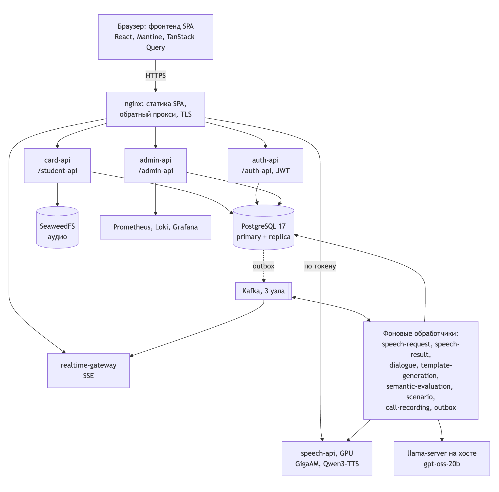
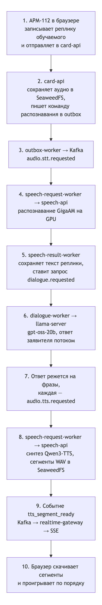
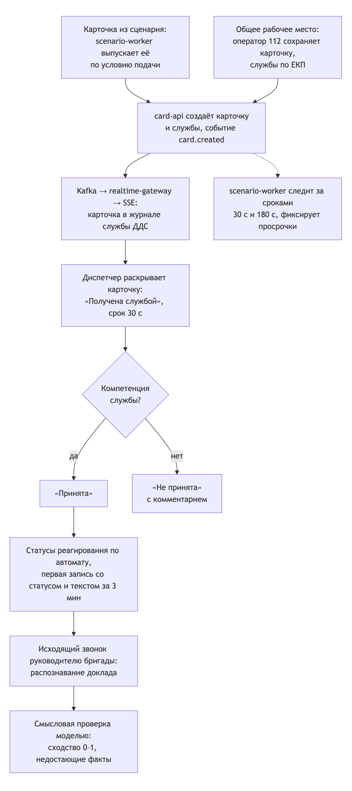
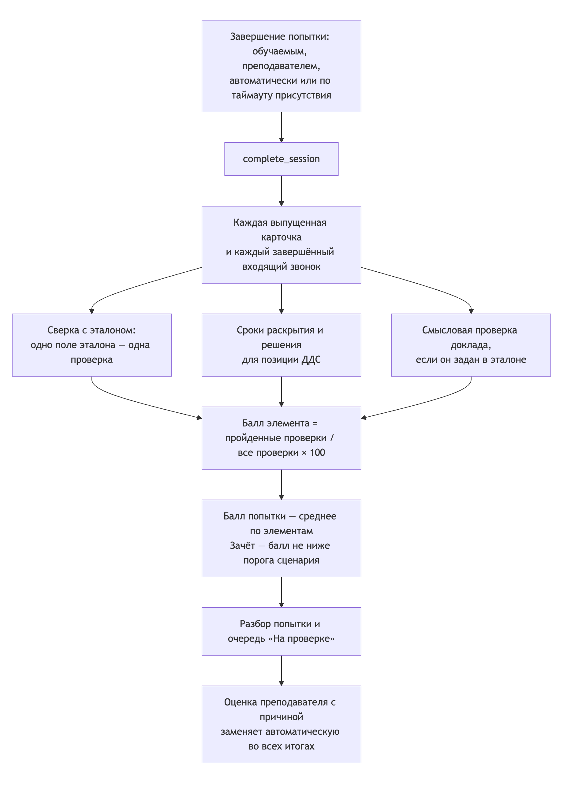

# 2. Архитектура

Раздел отвечает на требование ТЗ, разд. 13: описание функциональной и компонентной архитектуры.

## 2.1. Компоненты

Решение — набор контейнеров Docker Compose в одной локальной сети. Внешний вход один: nginx отдаёт собранный фронтенд и проксирует запросы к сервисам. Сервисы обмениваются данными через PostgreSQL, Apache Kafka (асинхронные команды и события) и хранилище SeaweedFS (аудио). Языковая модель работает вне Compose: это OpenAI-совместимый llama-server на хосте.

Рисунок 1 — Компоненты решения

Таблица 12 — Сервисы бэкенда

| Сервис | Реализация | Назначение |
|---|---|---|
| card-api | Python 3.12, FastAPI, SQLAlchemy async | Карточки, справочники, шаблоны, сценарии, назначения, группы, сессии, действия, аудиосообщения, контекст оценки. Чтения идут в реплику PostgreSQL |
| auth-api | FastAPI | Вход, профиль, продление и отзыв токена. JWT HS256 со сроком жизни 1 ч; пароли PBKDF2-SHA256 |
| realtime-gateway | FastAPI | Читает события из Kafka (`card.events`) и отдаёт их браузерам по SSE `GET /events` с фильтрами по рабочему пространству, карточке и преподавателю; heartbeat каждые 15 с |
| admin-api | FastAPI | Обзор стенда, мониторинг (Prometheus), журналы (Loki), пользователи, отчёты, политика безопасности, аудит |
| speech-api | FastAPI, PyTorch, CUDA | Распознавание речи GigaAM-v3, синтез речи Qwen3-TTS через C++-воркер на llama.cpp, склейка записи звонка (ffmpeg, MP3) |
| speech-tts-build | Одноразовая сборка | Собирает C++-воркер синтеза речи под CUDA |
| outbox-worker | Python | Транзакционный outbox: публикует события из PostgreSQL в Kafka (LISTEN/NOTIFY, запасной опрос 50 мс) |
| speech-request-worker | Python | Команды распознавания и синтеза из Kafka → вызовы speech-api → результаты в outbox |
| speech-result-worker | Python | Сохраняет расшифровки, ставит в очередь ответ заявителя и смысловую проверку доклада, публикует события для браузера |
| dialogue-worker | Python | Строит историю разговора, потоково запрашивает у модели ответ заявителя, режет поток на фразы и ставит каждую на синтез |
| template-generation-worker | Python | Генерирует связанные черновики шаблонов: звонок 112 и карточки ДДС |
| semantic-evaluation-request-worker, semantic-evaluation-result-worker | Python | Смысловое сравнение голосового доклада диспетчера с эталонным текстом |
| call-recording-worker | Python | Собирает запись завершённого звонка из реплик |
| scenario-worker | Python | Выпуск карточек и звонков по условиям сценария, процедурная подача, сроки 30 с и 180 с, присутствие обучаемого, автозавершение |
| audio-reconciler | Python | Удаляет осиротевшие аудиообъекты из хранилища |
| migrate | Alembic | Миграции схемы БД (28 ревизий), в том числе начальные учётные записи |
| PostgreSQL 17 | primary и потоковая реплика | Основное хранилище |
| Apache Kafka 3.4 | 3 узла в режиме KRaft, RF = 3 | Шина команд и событий, 9 топиков |
| SeaweedFS 4.47 | 3 мастера, 2 volume, 2 filer | Аудио реплик, сегменты синтеза, записи звонков |
| Prometheus, Grafana, Loki, Alloy, экспортёры | Наблюдаемость | Метрики (15 суток), журналы контейнеров (7 суток), дашборды; метрики GPU — профиль `gpu` |
| nginx, certbot | Вход в контур | Раздача SPA, прокси, TLS через Let's Encrypt (профиль `tls`) |
| llama-server (вне Compose) | llama.cpp, модель gpt-oss-20b | Диалог заявителя, генерация шаблонов, смысловая проверка доклада |

Топики Kafka: `card.events`, `audio.stt.requested.v1`, `audio.stt.completed.v1`, `audio.tts.requested.v1`, `audio.tts.completed.v1`, `dialogue.requested.v1`, `audio.processing.failed.v1`, `training.semantic-evaluation.requested.v1`, `training.semantic-evaluation.completed.v1`.

**Фронтенд** — React 18, TypeScript в строгом режиме, Vite, Mantine 8, TanStack Query 5, zustand, axios. Код организован по методологии Feature-Sliced Design, правила импорта между слоями проверяет линтер.

Таблица 13 — Слои фронтенда

| Слой | Назначение | Основные слайсы |
|---|---|---|
| app | Запуск, провайдеры, тема, роутинг с проверкой роли, связка HTTP-клиента с сессией | `providers`, `styles` |
| pages | Экраны | АРМ (`workspace-page`), кабинет преподавателя (`teacher-*`), обучаемого (`student-*`), администратора (`admin`), вход |
| widgets | Составные блоки нескольких экранов | оболочка кабинета, таблица попыток, просмотр эталона, памятка АРМ-112 |
| features | Пользовательские действия | вход, назначение занятия, форма эталона, генерация и проверка шаблонов, отчёты занятия |
| entities | Бизнес-сущности и их API | сценарий и шаблон, назначение, группа, мониторинг сессий, контекст оценки, классификатор ЕКП, сессия пользователя |
| shared | Инфраструктура без бизнес-логики | HTTP-клиент и контракты API, конфигурация и нормативы, даты, CSV, PDF, проверка орфографии, UI-обёртки |

Серверное состояние хранится только в кэше TanStack Query. Шрифт Roboto, словарь орфографии, классификатор и иконки входят в сборку, внешних запросов интерфейс не делает.

## 2.2. Потоки данных

### Голосовой звонок: речь → текст → ответ заявителя → синтез

Рисунок 2 — Поток данных голосового звонка

1. Браузер записывает реплику через MediaRecorder. Конец реплики определяется по паузе `call_vad_silence_ms`, по умолчанию 600 мс. Реплика загружается с ключом идемпотентности, ответ 202.
2. Файл сохраняется в SeaweedFS. В той же транзакции в outbox пишется команда распознавания.
3. Распознанный текст сохраняется как действие попытки и запускает ответ заявителя.
4. Ответ модели режется на произносимые фразы. Каждая фраза синтезируется голосом, заданным шаблоном.
5. Браузер получает события по SSE и проигрывает сегменты по порядку. При обрыве соединение восстанавливается через 3 с, состояние добирается запросом к REST.
6. После завершения звонка call-recording-worker собирает запись в MP3 для разбора.

### Карточка: оператор 112 → диспетчер ДДС

Рисунок 3 — Поток карточки от оператора 112 к диспетчеру ДДС

Карточка попадает к диспетчеру ДДС двумя путями:

- её выпускает scenario-worker по условию сценария: по времени от начала, после действия с другим элементом или процедурно из пула шаблонов;
- на общем рабочем месте её создаёт обучаемый в позиции оператора 112, и службы из списка оповещения получают её в свои журналы.

Сервер отдаёт диспетчеру только карточки, в которых есть его служба (`api/student/scenario_session/api.py`, фильтр по `position_code`). Раскрытие ставит статус «Получена службой». От раскрытия сервер отсчитывает 180 с до решения. Просрочки раскрытия и решения фиксирует scenario-worker.

### Оценка попытки

Рисунок 4 — Поток оценки попытки

Оценка запускается при завершении попытки обучаемым, преподавателем, автоматически по условиям сценария или при прерывании по таймауту присутствия. Алгоритм — раздел 3.5.

### Обновление интерфейса

- АРМ получает события по SSE: `fetch` с заголовком `Authorization` к `/realtime-gateway/events?workspace_id=…`, переподключение через 3 с (`pages/workspace-page/ui/use-workspace-events.ts`).
- Монитор преподавателя опрашивает сессии раз в 5 с и журнал действий раз в 10 с (`pages/teacher-lesson-monitor/api/use-live-monitor.ts`).

## 2.3. Хранилище

Таблица 14 — Хранилища данных

| Хранилище | Что хранит | Срок |
|---|---|---|
| PostgreSQL 17 | Пользователи, группы, шаблоны и их версии, сценарии, назначения, сессии, журнал действий попыток, карточки и статусы, оценки, outbox, аудит администратора, метаданные SeaweedFS | Автоматически не удаляется |
| SeaweedFS | Аудио реплик обучаемого, сегменты синтеза WAV, записи звонков MP3 | Осиротевшие объекты удаляет audio-reconciler |
| Kafka | Команды и события между сервисами | По настройкам топиков |
| Prometheus | Метрики | 15 суток |
| Loki | Журналы контейнеров | 7 суток |
| Браузер | Токен сессии вкладки (`sessionStorage`), свёрнутость меню, идентификаторы запущенных генераций (`localStorage`) | До закрытия вкладки или очистки |

ПДн — ФИО, телефоны, адреса, содержимое карточек — в хранилища браузера и URL не попадают.

## 2.4. Развёртывание

- **Хост.** Linux с Docker Engine, Docker Compose v2, драйвером NVIDIA и NVIDIA Container Toolkit. Полный стенд описан в корневом `docker-compose.yaml`: 43 сервиса, включая одноразовые `migrate`, `kafka-init`, `speech-tts-build`, `certbot`.
- **Вход.** nginx публикует порты 80 и 443. Пути `/student-api/`, `/auth-api/`, `/realtime-gateway/`, `/admin-api/` проксируются на card-api, auth-api, realtime-gateway и admin-api. `/speech-api/` пропускается только с действующим токеном: nginx проверяет его запросом к `auth-api /api/v1/auth/profile` (`frontend/nginx/https.conf.template`).
- **TLS.** Сертификат Let's Encrypt выпускает certbot (профиль `tls`). До выпуска сертификата nginx отвечает 503 на всё, кроме проверки домена. Внутри контура трафик не шифруется.
- **Авторизация.** В корневом Compose `S112_AUTH_ENABLED=true`: card-api, admin-api и realtime-gateway проверяют JWT и роль. На стенде обучаемый получает 403 на ручках преподавателя и администратора, преподаватель — на ручках администратора, запрос без токена — 401. В `backend/compose.yaml` для разработки авторизация по умолчанию выключена.
- **GPU.** Нужна speech-api: распознавание и синтез речи. Образ собирается на CUDA 13.0.2 с cuDNN, по умолчанию под архитектуру CUDA 7.5. llama-server с gpt-oss-20b работает на хосте и доступен контейнерам по `host.docker.internal:4555`.
- **Надёжность.** Долгоживущие сервисы перезапускаются автоматически (`restart: unless-stopped`). Kafka на трёх узлах с RF = 3, SeaweedFS на трёх мастерах, PostgreSQL с потоковой репликой без автоматического переключения.

Kubernetes не используется.

## 2.5. Работа в закрытом контуре заказчика

- Фронтенд не делает внешних запросов: шрифт, иконки, словарь орфографии и классификатор входят в сборку.
- Все модели работают локально: GigaAM-v3, Qwen3-TTS, gpt-oss-20b. Веса размещаются на сервере вручную, в репозиторий и образы не входят.
- Внешние обращения нужны только при установке: загрузка образов Docker и пакетов при сборке, выпуск сертификата Let's Encrypt. В закрытом контуре образы переносятся заранее, а сертификат выпускается внутренним удостоверяющим центром.
- Страницы Swagger UI сервисов (`/docs`) загружают скрипты с CDN jsdelivr и в закрытом контуре не открываются. Схемы OpenAPI (`/openapi.json`) доступны без внешних запросов.
