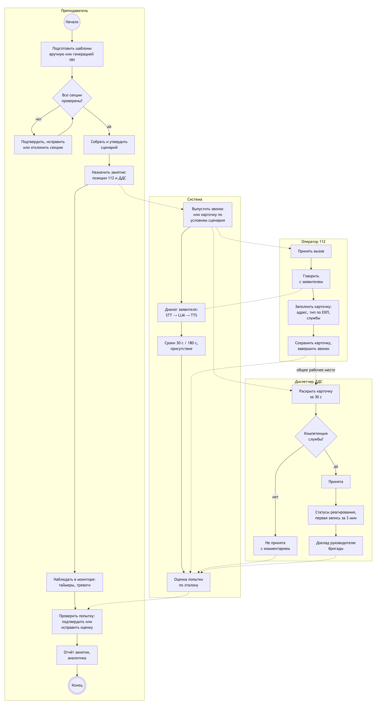

# 3. Описание работы алгоритмов

Раздел отвечает на требование ТЗ, разд. 13: используемые методы обработки данных. Пути к модулям даны от корня репозитория. Бэкенд — `backend/src/s112/`, фронтенд — `frontend/src/`.

## 3.1. Распознавание речи

Модули: `speech_api/service.py`, `speech_worker/request_worker.py`, `speech_worker/result_worker.py`.

1. Браузер записывает реплику обучаемого (webm, ogg или mp4) и загружает её, когда пауза в речи длится 600 мс (`call_vad_silence_ms`). Размер реплики — до 25 МиБ.
2. card-api сохраняет файл в SeaweedFS и в той же транзакции пишет в outbox команду `audio.stt.requested.v1`.
3. speech-request-worker вызывает `POST /api/v1/stt` сервиса speech-api.
4. speech-api распознаёт речь моделью **GigaAM-v3 e2e RNNT**. Модель загружается из локального каталога, без обращения в сеть. Длинные записи режутся на фрагменты не длиннее 18 с, на GPU кодировщик работает в fp16.
5. speech-result-worker сохраняет текст как действие попытки и ставит в очередь ответ собеседника: заявителя для оператора 112 или руководителя бригады для диспетчера ДДС.

Речь в оценке входящего звонка не участвует: звонок оценивается по итоговой карточке. Расшифровка нужна для диалога и для разбора.

## 3.2. Диалог ИИ-заявителя по легенде сценария

Модуль: `dialogue/worker.py`.

1. Легенда — шаблон входящего звонка: первая реплика заявителя, голос и эталон карточки. Всё, что задано в эталоне (адрес, пострадавшие, обстоятельства), заявитель «знает» и может сообщить. Чего в эталоне нет, он не выдумывает.
2. dialogue-worker собирает контекст: системный промпт роли, эталон как знания заявителя, первая реплика и последние 12 сообщений разговора (`dialogue_llm_history_messages`).
3. Запрос к модели **gpt-oss-20b** на llama-server идёт в потоковом режиме с низким усилием рассуждения.
4. Поток токенов режется на произносимые фразы. Каждая фраза сразу уходит на синтез, поэтому первая фраза звучит, пока модель дописывает ответ.
5. Диспетчер ДДС разговаривает с руководителем бригады тем же механизмом.

## 3.3. Синтез речи и запись звонка

Модули: `speech_api/service.py`, `backend/tts-worker/` (C++), `audio/recording_worker.py`.

- Модель **Qwen3-TTS 12Hz 0.6B Base** в формате GGUF (Q8_0) с проектором F16 работает через собственный C++-воркер на llama.cpp с CUDA.
- Голос клонируется по референсной записи из каталога `models/refs`. Шаблон звонка хранит идентификатор голоса; генератор шаблонов выбирает мужской или женский голос по полу заявителя.
- Текст режется на сегменты до 120 символов, между сегментами — пауза 120 мс. Сегменты хранятся в SeaweedFS в WAV.
- Браузер получает событие `tts_segment_ready` по SSE и проигрывает сегменты по порядку. Пока ответ готовится, на АРМ виден индикатор «Собеседник отвечает…».
- После завершения звонка call-recording-worker склеивает реплики в запись MP3 для разбора.

## 3.4. Генерация шаблонов ИИ и проверка по секциям

Модули: `template_generation/worker.py`, `template_generation/client.py`; интерфейс — `features/generate-templates`, `features/template-review`.

1. Преподаватель выбирает основную службу (101–104) и при необходимости дополнительные. Запрос `POST /api/v1/card-template-generations` ставит генерацию в очередь, ответ 202.
2. Сервер подбирает тип происшествия из классификатора по основной службе и учебный адрес.
3. Модель заполняет факты по JSON-схеме с температурой 0,2: описание, заявитель, адрес, пострадавшие, сложность.
4. Результат проверяется программно (`_validate_generated_facts`). Если проверка не пройдена, генерация получает статус FAILED с причиной, и черновики не создаются. Проверяется, что:
   - адрес начинается с «г. Москва,», описание дословно содержит адрес;
   - адрес со слов заявителя совпадает с местом происшествия;
   - описание не противоречит выбранному типу классификатора и не содержит действий служб;
   - голоса мужского и женского заявителя различаются;
   - общие поля звонка 112 и карточек ДДС одной генерации совпадают.
5. Шаблоны сохраняются черновиками «Черновик ИИ» с разбивкой на секции: классификация, адрес, службы, статусы реагирования, доклад и другие.
6. Преподаватель по каждой секции выбирает «подтвердить», «исправить в редакторе» или «отклонить». Сервер не публикует шаблон, пока все секции не подтверждены или не исправлены. В сценарии можно включать только опубликованные шаблоны.

Сложность шаблона модель предлагает, преподаватель её корректирует.

## 3.5. Оценка попытки

Модули: `api/simulation_service.py` — `_evaluate_session_work`, `_evaluate_card`, `_evaluate_incoming_call`, `_compare_expected`, `_normalize_address`; `semantic_evaluation/*`.

**Сверка карточки с эталоном.** Эталон задаёт итоговое состояние карточки, а для ДДС — ещё историю статусов и доклад. Каждое поле эталона — одна проверка.

Таблица 15 — Способы сравнения полей с эталоном

| Поле | Способ сравнения |
|---|---|
| Классификация: группа, признаки, итоговый тип, флаги маршрутизации | Строго |
| Службы в списке оповещения | Как множество, без учёта порядка |
| ФИО заявителя | Без учёта регистра, пунктуации, лишних пробелов и различия «ё/е» |
| Адрес со слов заявителя и место происшествия | То же плюс приведение сокращений: «улица → ул», «дом → д», «корпус → корп», «строение → стр», «квартира → кв», «пр-т → проспект», «б-р → бульвар», «переулок → пер», «шоссе → ш», «проезд → пр» |
| Телефоны, число пострадавших, статус карточки, статусы служб | Строго |
| История статусов службы | Длина и каждый переход; номер бригады не сравнивается |
| Сроки раскрытия и решения (позиция ДДС) | 30 с до раскрытия, 180 с от раскрытия до решения |
| Описание, комментарии к статусам | Не оцениваются, хранятся для разбора |
| Доклад руководителю бригады | Смысловое сравнение моделью |

Поле эталона можно исключить из проверки или потребовать пустое значение. Режим задаётся для каждого поля в редакторе.

**Балл и зачёт.**

- Балл элемента (карточки или звонка) = пройденные проверки / все проверки × 100.
- Балл попытки — среднее по всем выпущенным карточкам и завершённым входящим звонкам.
- Зачёт — балл не ниже порога сценария (0–100, по умолчанию 100).
- Оценка считается синхронно в запросе завершения попытки, в том числе при прерывании.

**Сходство доклада и порог.** Голосовой доклад диспетчера распознаётся и отправляется модели вместе с эталонным текстом (температура 0). Модель возвращает JSON: сходство 0–1, недостающие факты, противоречия (`semantic_evaluation/client.py`). Доклад засчитывается при сходстве не ниже порога из эталона, по умолчанию 0,8 (`semantic_evaluation/rules.py`). Если модель не ответила, проверка помечается «не выполнена» и ошибкой обучаемого не считается.

**Адресные ошибки.** Адрес со слов заявителя — критическое поле. Форма АРМ собирает его из частей: «г. Москва» + улица, дом, корпус, строение, подъезд, квартира. Место происшествия — тот же адрес плюс описательный адрес («во дворе», «контейнерная площадка»). Страна, округ и район не добавляются: в эталонах их нет, и они давали бы ложное расхождение. В разборе отличающиеся символы адреса подсвечиваются посимвольно (`shared/lib/char-diff.ts`), чтобы была видна ошибка вида «Дубнинская / Дубининская».

**Орфография** (`shared/lib/spelling/`):

- проверяется текст, введённый обучаемым: описание и адреса карточки из звонка, комментарии ДДС к решениям и статусам;
- проверка идёт офлайн в браузере библиотекой nspell с русским словарём Hunspell. Словарь около 3,5 МБ загружается лениво и разбирается в Web Worker;
- не проверяются слова с заглавной буквы, слова короче 3 букв, слова из эталона и названия типов происшествий;
- результат — блок «Грамотность ввода» в разборе и колонка в таблице, PDF и CSV занятия с подписью «Автоматическая проверка орфографии, может ошибаться на названиях»;
- в балл орфография не входит: сервер описание и комментарии не оценивает.

## 3.6. Нормативы 30 с / 3 мин

Нормативы фиксированы по уточнению заказчика (`shared/config/time-norms.ts`), преподаватель их не меняет.

Таблица 16 — Нормативы и способ расчёта

| Норматив | Значение | Как считается |
|---|---|---|
| Раскрытие карточки | 30 с | От появления карточки в службе до открытия диспетчером |
| Первая запись | 3 мин | От появления карточки до первой записи: статус вместе с непустым комментарием |

- **Сервер** (`scenario_worker/worker.py`) выставляет сроки раскрытия (30 с) и решения (180 с от открытия карточки), выпускает события просрочки и учитывает сроки в балле. Поздние действия разрешены, но засчитываются как нарушение.
- **Монитор, отчёт занятия и «Мои результаты»** считают нормативы по журналу действий попытки одной функцией (`entities/monitoring/model/lesson-monitor.ts`) строго в формулировке заказчика. Таймер переходит в предупреждение на 70 % норматива.
- **Присутствие.** АРМ подтверждает присутствие каждые 5 с (`pages/workspace-page/ui/use-training-presence.ts`). Если подтверждения нет 30 с (`presence_timeout_seconds`), сервер прерывает попытку с причиной `PRESENCE_TIMEOUT` и оценивает выполненное (`scenario_worker/presence.py`).

Расхождение сервера с уточнением заказчика описано в разделе 8.

## 3.7. Аналитика и прогноз

Модули: `pages/teacher-analytics/model/` — `student-stats.ts`, `analytics-rules.ts`, `group-insights.ts`, `domain-facts.ts`, `forecast.ts`, `analytics-report.ts`.

Аналитика считается в браузере по данным, которые интерфейс уже загружает: попытки, назначения, сценарии и контекст оценки каждой попытки за выбранный период и группу. Пороги — именованные константы.

Таблица 17 — Показатели аналитики

| Показатель | Методика |
|---|---|
| Сводные плитки | Попытки, средний итоговый балл, доля зачтённых, доля в нормативе 30 с / 3 мин, орфографические ошибки на попытку; изменение к прошлому периоду |
| Тепловая карта ошибок | Строки — обучаемые, столбцы — группы проверок разбора: классификация, службы, полнота, адрес, тайминг, статусы, доклад. Ячейка — доля попыток с ошибкой среди попыток, где проверка применима к роли |
| Готовность | По последним 5 попыткам: «готов к самостоятельной работе» — балл ≥ 85, зачтено ≥ 80 %, нормативы ≥ 90 %; «уверенно, есть поправки» — балл ≥ 70, зачтено ≥ 50 %, нормативы ≥ 70 %; иначе «нужна практика». У оператора 112 нормативы не учитываются |
| Рекомендуемая сложность | По последним 3 попыткам на текущей сложности: все зачтены и средний ≥ 85 — повысить; зачтено меньше половины или средний < 60 — понизить; иначе оставить |
| Лидеры и отстающие | По среднему баллу среди обучаемых минимум с 2 попытками. У лидеров — группы проверок без ошибок, у отстающих — две группы с наибольшей долей ошибок |
| Ошибки в адресах | Звонки 112, где эталон задаёт адрес со слов заявителя; ошибка — расхождение сервера по полю `card.reported_address` |
| Службы, которые забывают оповестить | Каждая служба эталона в каждом звонке: есть ли она в итоговой карточке оператора |
| Время по статусам ДДС | От первого раскрытия карточки до первых «Принята», «Начало реагирования», «Прибытие», «Работы завершены» |

**Прогноз на следующее занятие** (`forecast.ts`):

- балл занятия — средний итоговый балл обучаемого в нём, занятия упорядочены по времени;
- прогноз — экспоненциальное сглаживание с трендом (метод Хольта): коэффициент уровня 0,5, тренда 0,3; результат ограничен шкалой 0–100;
- интервал — ± стандартное отклонение прошлых баллов, но не уже 5 баллов; по одному занятию тренда нет, интервал ±15;
- зона риска — ожидаемый балл ниже порога зачёта или нормативы соблюдаются реже чем в 50 % случаев.

**Проверка «прогноз ↔ факт».** Для каждого обучаемого и каждого занятия, кроме первого, прогноз строится только по предыдущим занятиям и сравнивается с фактическим баллом. Показываются средняя абсолютная ошибка метода, та же ошибка у наивного прогноза (среднее прошлых баллов), доля попаданий факта в интервал и точечный график «прогноз × факт». При числе пар меньше 10 интерфейс помечает выводы как предварительные.

**Результат на стенде 29.09.2026 — предварительный.** Сравнено 9 пар. Средняя ошибка метода — 29,7 балла, у наивного прогноза — 31,9. Факт попал в интервал в 67 % случаев. Истории мало, баллы тестовых попыток сильно разбросаны: много прерванных попыток с нулевым баллом. Вывод: метод не хуже наивного, точность на такой выборке низкая.

**Отчёты.** PDF занятия и аналитики собираются в браузере (pdfmake), таблицы выгружаются в CSV.

## 3.8. Интерпретируемость: что видит преподаватель

- **Путь раскрытия балла:** итог → критерий C1–C7 → поле или признак → момент в журнале действий и в записи звонка.
- **Расхождения с эталоном** сгруппированы по карточкам. Для каждого указаны ожидаемое и введённое значение, адрес подсвечен посимвольно.
- **Классификация** показана названиями признаков и типа, а не кодами.
- **Доклад** проверяется построчно: что сказал обучаемый, что должно было прозвучать, чего не хватает, какие факты противоречат эталону.
- **Запись звонка и расшифровка** в виде реплик; щелчок по реплике перематывает запись.
- **Выводы модели** подписаны как требующие проверки преподавателем.
- **Экспертная оценка.** «Верно — подтвердить» сохраняет оценку, равную автоматической. «Исправить» требует причину. Оценка преподавателя заменяет автоматическую во всех итогах, отчётах и у обучаемого; изменение пишется в журнал попытки.
- **Очередь проверки:** без оценки преподавателя — «На проверке», совпала с автоматической — «Подтверждены», отличается — «Исправлены». Прерванные попытки в очередь не попадают.

## 3.9. Почему ИИ не выносит итоговую оценку

- **Воспроизводимость.** Одна и та же карточка с тем же эталоном даёт тот же балл. У языковой модели ответ зависит от формулировки и может меняться между запусками.
- **Проверяемость.** Каждая проверка сводится к полю эталона и способу сравнения. Решение модели пришлось бы объяснять задним числом.
- **Позиция заказчика.** Преподаватель — конечный валидатор, ИИ не настаивает против преподавателя.
- **Где модель всё же нужна**, её вывод ограничен: доклад оценивается по порогу сходства с эталонным текстом, недоступность модели не превращается в ошибку обучаемого, генерация шаблонов проходит программную проверку и проверку преподавателем.

## 3.10. Схема процесса занятия в нотации BPMN

Схема показывает занятие от подготовки до отчёта. Дорожки — участники: преподаватель, система, обучаемый в позиции оператора 112, обучаемый в позиции диспетчера ДДС. Обозначения: тонкий кружок — начальное событие, двойной — конечное; прямоугольник — задача; ромб — исключающий шлюз; сплошная стрелка — поток управления внутри дорожки, пунктирная — передача между участниками.

Рисунок 5 — Процесс занятия в нотации BPMN

## 3.11. Замеры

Замеры выполнены на стенде https://112-edu-justdoitteam.ru 29.09.2026 из внешней сети. Время ответа простого запроса `GET /student-api/health` из той же сети — около 1 с (в него входит установка TLS-соединения), это нужно учитывать при чтении таблицы.

Таблица 18 — Замеры на стенде

| Что измерялось | Как | Результат |
|---|---|---|
| Ответ заявителя: от загрузки реплики до получения браузером первого аудиосегмента ответа | Живой звонок в АРМ-112, 2 реплики | 7,4 с и 5,7 с. Загрузка самой реплики — 1,2 с |
| Генерация шаблонов моделью: от начала обработки до готовых черновиков | Поля `started_at` и `completed_at` генерации: 10 ранее выполненных и 4 новых | Успешные генерации на одну службу — 9,9–15,1 с, медиана 10,8 с (7 замеров). На две службы — 10,1 с (1 замер). Две генерации завершились ошибкой: одна через 76,7 с, другая отклонена проверкой согласованности через 9,3 с. Четыре генерации от 27.09.2026 длились 0,09–0,15 с; это не соответствует работе модели, причина не выяснена, в расчёт они не взяты |
| Оценка попытки ДДС с одной карточкой | Время запроса прерывания попытки, внутри которого считается оценка, 3 замера | 0,75–1,04 с вместе с сетью, то есть сама оценка — доли секунды |
| Смысловая проверка доклада моделью | — | Не измерялась: выполняется асинхронно, отдельной метки времени у результата в API нет |
| Время отклика интерфейса под нагрузкой, пропускная способность, скорость записи в БД, время построения аналитики | — | Не измерялись: нагрузочное тестирование не проводилось |
