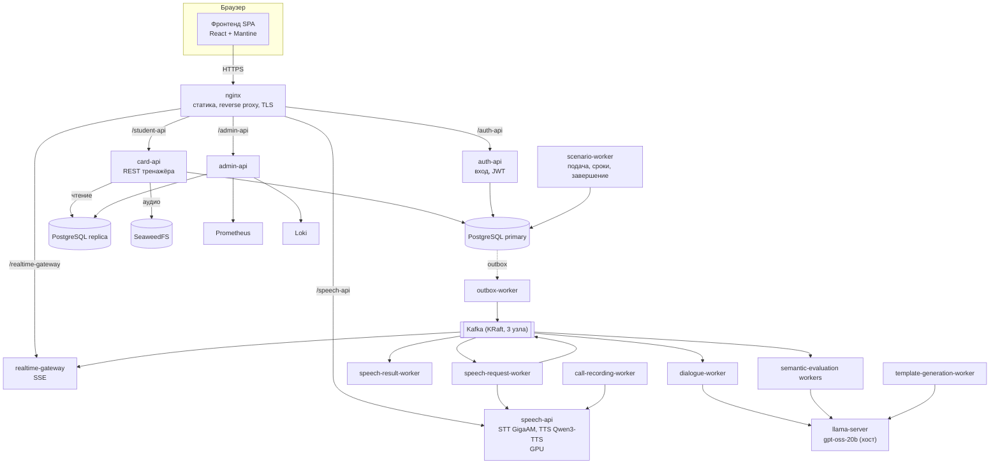
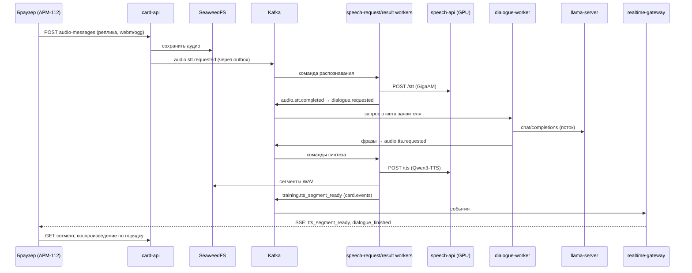
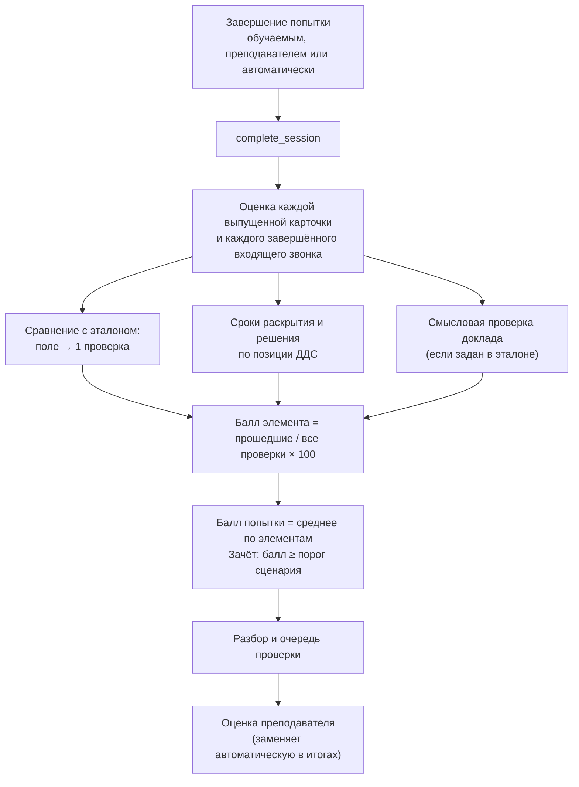

# 3. Компонентная архитектура

## 3.1. Общая схема

Решение — набор контейнеров Docker Compose в одной локальной сети. Внешний вход один: nginx
отдаёт собранный фронтенд и проксирует запросы к сервисам. Сервисы общаются через PostgreSQL,
Apache Kafka (асинхронные команды и события) и хранилище SeaweedFS (аудио). Языковая модель
работает вне compose — это OpenAI-совместимый llama-server на хосте.

## 3.2. Сервисы бэкенда

| Сервис | Реализация | Назначение |
|---|---|---|
| card-api | Python 3.12, FastAPI, SQLAlchemy async | Карточки, справочники, шаблоны, сценарии, назначения, группы, сессии, действия, аудиосообщения, контекст оценки. Чтения идут в реплику PostgreSQL |
| auth-api | FastAPI | Вход, профиль, продление и отзыв токена. JWT HS256, срок жизни 1 ч; пароли PBKDF2-SHA256 |
| realtime-gateway | FastAPI | Читает события из Kafka (`card.events`) и отдаёт их браузерам по SSE `GET /events` с фильтрами по рабочему пространству, карточке и преподавателю; heartbeat каждые 15 с |
| admin-api | FastAPI | Обзор стенда, мониторинг (Prometheus), журналы (Loki), пользователи, отчёты, политика безопасности, аудит |
| speech-api | FastAPI + PyTorch, CUDA | `POST /api/v1/stt` — распознавание речи моделью GigaAM-v3 e2e RNNT; `POST /api/v1/tts` — синтез речи Qwen3-TTS 0.6B (GGUF) через C++-воркер на llama.cpp с клонированием голоса по референсу; `POST /api/v1/call-recordings/compose` — склейка записи звонка (ffmpeg, MP3) |
| speech-tts-build | Одноразовая сборка | Собирает C++-воркер синтеза речи под CUDA |
| outbox-worker | Python | Транзакционный outbox: публикует события из PostgreSQL в Kafka (LISTEN/NOTIFY, запасной опрос 50 мс) |
| speech-request-worker | Python | Команды распознавания и синтеза из Kafka → вызовы speech-api → результаты в outbox |
| speech-result-worker | Python | Сохраняет расшифровки, ставит в очередь ответ заявителя и смысловую проверку доклада, публикует события для браузера |
| dialogue-worker | Python | Строит историю разговора, потоково запрашивает у модели ответ заявителя, режет поток на фразы и ставит каждую на синтез речи |
| template-generation-worker | Python | Генерирует связанные черновики шаблонов (звонок 112 и карточки ДДС) по JSON-схеме с проверкой согласованности |
| semantic-evaluation-request / result-worker | Python | Смысловое сравнение голосового доклада диспетчера с эталонным текстом |
| call-recording-worker | Python | Собирает запись завершённого звонка из реплик |
| scenario-worker | Python | Выпуск карточек и звонков по условиям сценария, процедурная подача, контроль сроков 30 с / 180 с, присутствие обучаемого, автозавершение |
| audio-reconciler | Python | Удаляет осиротевшие аудиообъекты из хранилища |
| migrate | Alembic | Миграции схемы БД (28 ревизий), в том числе начальные учётные записи |
| PostgreSQL 17 | primary + streaming replica | Основное хранилище; также метаданные SeaweedFS |
| Apache Kafka 3.4 | 3 узла в режиме KRaft, RF = 3 | Шина команд и событий: 9 топиков (см. ниже) |
| SeaweedFS 4.47 | 3 мастера, 2 volume, 2 filer | Хранение аудио реплик, синтезированных сегментов и записей звонков |
| Prometheus, Grafana, Loki, Alloy, экспортёры | Наблюдаемость | Метрики (15 суток), журналы контейнеров (7 суток), дашборды; метрики GPU — профиль `gpu` |
| nginx + certbot | Вход в контур | Раздача SPA, прокси, TLS через Let's Encrypt (профиль `tls`) |
| llama-server (вне compose) | llama.cpp, модель gpt-oss-20b | Диалог заявителя, генерация шаблонов, смысловая проверка доклада |

Топики Kafka: `card.events`, `audio.stt.requested.v1`, `audio.stt.completed.v1`,
`audio.tts.requested.v1`, `audio.tts.completed.v1`, `dialogue.requested.v1`,
`audio.processing.failed.v1`, `training.semantic-evaluation.requested.v1`,
`training.semantic-evaluation.completed.v1`.

## 3.3. Фронтенд

React 18, TypeScript (strict), Vite, Mantine 8, TanStack Query 5, zustand, axios. Код организован
по методологии Feature-Sliced Design; правила импорта между слоями проверяются линтером.

| Слой | Назначение | Основные слайсы |
|---|---|---|
| app | Запуск, провайдеры, тема, роутинг с проверкой роли, связка HTTP-клиента с сессией, заголовки вкладок | `providers`, `styles` |
| pages | Экраны | АРМ (`workspace-page`), кабинет преподавателя (`teacher-*`), обучаемого (`student-*`), администратора (`admin`), вход |
| widgets | Составные блоки нескольких экранов | шапка кабинета, таблица попыток, просмотр эталона, памятка АРМ-112, шапка АРМ |
| features | Пользовательские действия | вход, назначение занятия, форма эталона, генерация и проверка шаблонов, отчёты занятия |
| entities | Бизнес-сущности и их API | сценарий и шаблон, назначение, группа, обучаемый, мониторинг сессий, контекст оценки, классификатор ЕКП, сессия пользователя |
| shared | Инфраструктура без бизнес-логики | HTTP-клиент и контракты API, конфигурация и нормативы, форматирование дат, CSV, проверка орфографии, UI-обёртки |

Серверное состояние хранится только в кэше TanStack Query с фабриками ключей по сущностям.
Токен доступа держится в памяти вкладки и не попадает в хранилища браузера. Все ассеты — шрифт
Roboto, словарь орфографии, иконки — входят в сборку, внешних запросов нет.

## 3.4. Поток данных голосового звонка

1. Браузер записывает реплику через MediaRecorder. Конец реплики определяется по паузе
   (`vad_silence_ms`, по умолчанию 600 мс). Реплика загружается с ключом идемпотентности,
   ответ 202.
2. Файл сохраняется в SeaweedFS. В той же транзакции пишется команда распознавания в outbox.
3. Распознанный текст сохраняется как действие попытки и запускает ответ заявителя. Модель
   получает системный промпт, первую реплику заявителя из шаблона и последние 12 сообщений.
4. Ответ модели режется на произносимые фразы; каждая синтезируется голосом, заданным шаблоном.
5. Браузер получает события по SSE и проигрывает сегменты по порядку. Если соединение
   рвётся, состояние восстанавливается запросом к REST.
6. После завершения звонка call-recording-worker собирает запись в MP3 для разбора.

## 3.5. Поток данных оценки попытки

