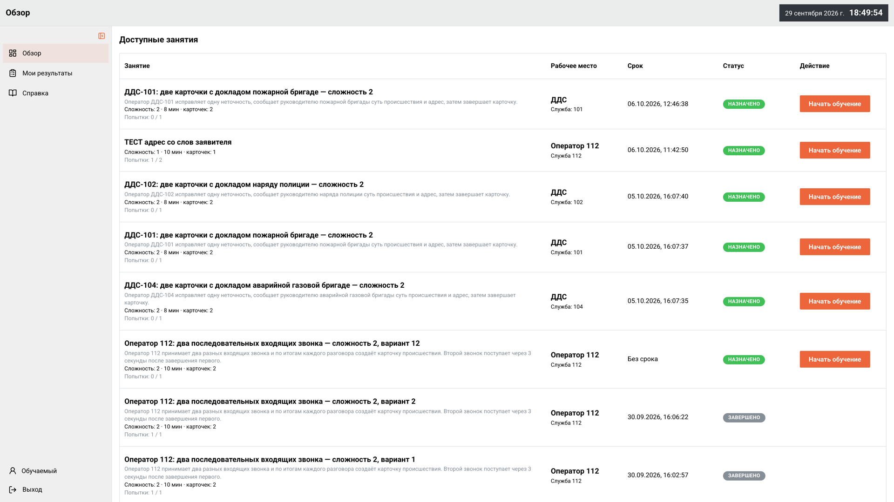
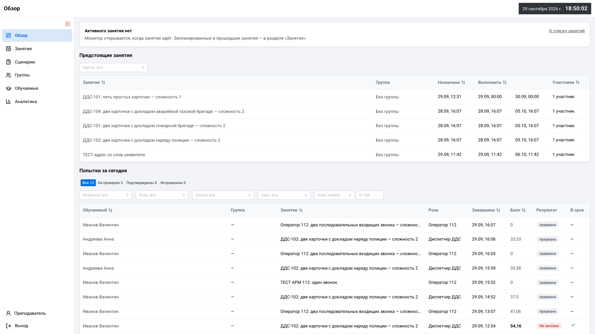

# 7. Способ взаимодействия

Раздел описывает, как с решением работают пользователи и внешние модули.

Таблица 36 — Способы взаимодействия

| Способ | Где | Для чего |
|---|---|---|
| Веб-интерфейс | https://112-edu-justdoitteam.ru | Рабочие места и кабинеты всех ролей |
| HTTP API | `/student-api`, `/auth-api`, `/realtime-gateway`, `/admin-api` за nginx; схемы OpenAPI — `/<сервис>/openapi.json` | Интеграция и расширение собственными модулями (ТЗ, разд. 6) |
| События | SSE `GET /realtime-gateway/events` | Обновление АРМ в реальном времени |

## 7.1. Веб-интерфейс по ролям

После входа пользователь попадает в раздел своей роли. Открытый по прямой ссылке раздел другой роли возвращает его в свой. Пошаговое описание экранов — раздел 10.

Таблица 37 — Разделы интерфейса по ролям

| Роль | Разделы |
|---|---|
| Обучаемый | «Обзор» с назначенными занятиями, АРМ-112 или АРМ ДДС по позиции в назначении, «Мои результаты», «Справка» с памяткой «Работа на АРМ-112» |
| Преподаватель | «Обзор», «Занятия» с назначением и страницей занятия, монитор занятия, «Сценарии» и «Шаблоны» с генерацией ИИ, «Группы», «Обучаемые», разбор попытки, «Аналитика» |
| Администратор | «Обзор», «Мониторинг», «Пользователи», «Отчёты», «Сервисы», «Резервные копии», «Обновления», «Безопасность» |

Кабинеты работают на экранах от 375 px по ширине. АРМ рассчитан на широкий монитор.

Рисунок 6 — Вход в систему

Рисунок 7 — «Обзор» обучаемого: назначенные занятия

Рисунок 8 — «Обзор» кабинета преподавателя

## 7.2. HTTP API

Каждый сервис — FastAPI-приложение с автоматической схемой OpenAPI. За nginx схемы доступны по адресам:

- https://112-edu-justdoitteam.ru/student-api/openapi.json — card-api;
- https://112-edu-justdoitteam.ru/auth-api/openapi.json — auth-api;
- https://112-edu-justdoitteam.ru/realtime-gateway/openapi.json — realtime-gateway;
- https://112-edu-justdoitteam.ru/admin-api/openapi.json — admin-api.

Страницы Swagger UI (`/<сервис>/docs`) за nginx не работают: они запрашивают схему с корня сайта и загружают скрипты с CDN.

Конвенции API:

- префикс `/api/v1`, у admin-api — `/api/v1/admin`; `/health` без префикса;
- ключи в `snake_case`, дата и время в ISO-8601;
- список — JSON-массив; у пользователей и аудита admin-api — объект `{items, total, limit, offset}`;
- ошибка — `{"detail": ...}`, валидация — 422 со списком `{loc, msg, type}`;
- конкурентность — обязательные `expected_version`, `expected_card_version`, `expected_revision` в изменяющих запросах;
- идемпотентность — заголовок `Idempotency-Key` на старте попытки и загрузке реплики, поле `request_id` в телах;
- авторизация — `Authorization: Bearer <JWT>` и `X-User-Id`.

Таблицы ниже составлены по схемам OpenAPI стенда на 29.09.2026. Ручки журналов admin-api (`/logs*`) на стенде есть, а в репозитории их модуля нет (раздел 8).

Таблица 38 — Ручки card-api

| Метод | Путь | Назначение |
|---|---|---|
| GET | `/health` | Проверка работоспособности |
| GET | `/api/v1/event-types` | Типы происшествий |
| GET | `/api/v1/event-types/{event_type_id}/event-kinds` | Виды происшествий по типу |
| GET | `/api/v1/services` | Справочник служб |
| POST | `/api/v1/services` | Добавить службу в справочник |
| POST | `/api/v1/cards` | Создать карточку |
| GET | `/api/v1/cards` | Список карточек |
| GET | `/api/v1/cards/{card_id}` | Карточка целиком |
| PATCH | `/api/v1/cards/{card_id}` | Правка карточки с `expected_version` |
| GET | `/api/v1/cards/{card_id}/feature-history` | История признаков карточки |
| GET | `/api/v1/cards/{card_id}/status-history` | История статусов карточки |
| GET | `/api/v1/cards/{card_id}/services` | Службы карточки |
| POST | `/api/v1/cards/{card_id}/services` | Добавить службу в карточку |
| PUT | `/api/v1/cards/{card_id}/features` | Задать признаки классификатора |
| POST | `/api/v1/cards/{card_id}/statuses` | Сменить статус карточки |
| POST | `/api/v1/card-services/{card_service_id}/statuses` | Статус реагирования службы |
| GET | `/api/v1/card-services/{card_service_id}/status-history` | История статусов службы |
| POST | `/api/v1/card-templates` | Создать шаблон карточки ДДС |
| GET | `/api/v1/card-templates` | Список шаблонов карточек |
| GET | `/api/v1/card-templates/{template_id}` | Шаблон карточки |
| PATCH | `/api/v1/card-templates/{template_id}` | Правка шаблона, решения по секциям, публикация |
| DELETE | `/api/v1/card-templates/{template_id}` | Деактивация шаблона |
| POST | `/api/v1/card-template-generations` | Запустить генерацию шаблонов моделью |
| GET | `/api/v1/card-template-generations/{generation_id}` | Состояние генерации |
| POST | `/api/v1/card-templates/{template_id}/upgrade-scenarios` | Перевести черновики сценариев на новую версию шаблона |
| POST | `/api/v1/incoming-call-templates` | Создать шаблон входящего звонка |
| GET | `/api/v1/incoming-call-templates` | Список шаблонов звонков |
| GET | `/api/v1/incoming-call-templates/{template_id}` | Шаблон звонка |
| PATCH | `/api/v1/incoming-call-templates/{template_id}` | Правка шаблона звонка |
| DELETE | `/api/v1/incoming-call-templates/{template_id}` | Деактивация шаблона звонка |
| POST | `/api/v1/incoming-call-templates/{template_id}/upgrade-scenarios` | Перевести черновики сценариев на новую версию шаблона звонка |
| POST | `/api/v1/training-scenarios` | Создать сценарий |
| GET | `/api/v1/training-scenarios` | Список сценариев |
| GET | `/api/v1/training-scenarios/{scenario_id}` | Сценарий с элементами |
| PATCH | `/api/v1/training-scenarios/{scenario_id}` | Правка черновика и утверждение с `expected_revision` |
| DELETE | `/api/v1/training-scenarios/{scenario_id}` | Архивировать сценарий |
| GET | `/api/v1/students` | Список обучаемых |
| POST | `/api/v1/learning-groups` | Создать группу |
| GET | `/api/v1/learning-groups` | Список групп |
| GET | `/api/v1/learning-groups/{group_id}` | Группа |
| PATCH | `/api/v1/learning-groups/{group_id}` | Переименовать, архивировать группу |
| POST | `/api/v1/learning-groups/{group_id}/members` | Добавить обучаемых в группу |
| DELETE | `/api/v1/learning-groups/{group_id}/members/{student_id}` | Исключить обучаемого из группы |
| POST | `/api/v1/learning-groups/{group_id}/scenario-assignments` | Назначить занятие группе |
| POST | `/api/v1/scenario-assignments` | Назначить занятие обучаемым |
| GET | `/api/v1/scenario-assignments` | Список назначений |
| PATCH | `/api/v1/scenario-assignments/{assignment_id}` | Перенести занятие |
| DELETE | `/api/v1/scenario-assignments/{assignment_id}` | Отменить занятие без попыток |
| PATCH | `/api/v1/assignment-batches/{batch_id}` | Перенести пакет назначений |
| DELETE | `/api/v1/assignment-batches/{batch_id}` | Отменить пакет назначений |
| GET | `/api/v1/teacher/scenario-assignments/{assignment_id}` | Назначение глазами преподавателя |
| GET | `/api/v1/student/scenario-assignments` | Свои назначения обучаемого |
| GET | `/api/v1/student/scenario-assignments/{assignment_id}` | Своё назначение |
| POST | `/api/v1/scenario-assignments/{assignment_id}/ready` | Готовность участника общего места |
| POST | `/api/v1/scenario-assignments/{assignment_id}/start` | Начать попытку, `Idempotency-Key` обязателен |
| GET | `/api/v1/student/training-history` | Своя история попыток |
| GET | `/api/v1/student/training-sessions/{session_id}/result` | Свой результат попытки |
| GET | `/api/v1/training-sessions` | Список попыток |
| GET | `/api/v1/training-sessions/{session_id}` | Попытка |
| GET | `/api/v1/students/{student_id}/training-history` | История попыток обучаемого |
| GET | `/api/v1/training-sessions/{session_id}/expert-review-context` | Контекст разбора: эталон, расхождения, журнал |
| PUT | `/api/v1/training-sessions/{session_id}/expert-assessment` | Оценка преподавателя с комментарием |
| POST | `/api/v1/training-sessions/{session_id}/abort` | Прервать попытку |
| GET | `/api/v1/teacher-monitoring/sessions` | Сессии монитора преподавателя |
| GET | `/api/v1/teacher-monitoring/sessions/{session_id}` | Сессия монитора |
| POST | `/api/v1/training-sessions/{session_id}/scheduled-cards/{scenario_card_key}/release` | Ручной выпуск карточки сценария |
| POST | `/api/v1/training-sessions/{session_id}/incoming-calls/{scenario_item_key}/release` | Ручной выпуск входящего звонка |
| GET | `/api/v1/training-sessions/{session_id}/actions` | Журнал действий попытки |
| GET | `/api/v1/training-sessions/{session_id}/scheduled-cards` | Запланированные карточки |
| GET | `/api/v1/training-sessions/{session_id}/incoming-calls` | Звонки попытки |
| GET | `/api/v1/training-calls/{call_id}/transcript` | Расшифровка звонка |
| GET | `/api/v1/training-calls/{call_id}/recording` | Состояние записи звонка |
| GET | `/api/v1/training-calls/{call_id}/recording/content` | Файл записи MP3 |
| POST | `/api/v1/training-sessions/{session_id}/presence` | Подтверждение присутствия АРМ |
| GET | `/api/v1/training-sessions/{session_id}/completion-readiness` | Готовность к завершению и блокеры |
| POST | `/api/v1/training-sessions/{session_id}/complete` | Завершить попытку и оценить |
| GET | `/api/v1/workspaces/{workspace_id}/cards` | Карточки рабочего пространства; диспетчер видит только свою службу |
| GET | `/api/v1/workspaces/{workspace_id}/cards/{card_id}` | Карточка рабочего пространства |
| POST | `/api/v1/workspaces/{workspace_id}/cards/{card_id}/open` | Раскрыть карточку |
| POST | `/api/v1/workspaces/{workspace_id}/cards/{card_id}/decision` | Решение «Принята» или «Не принята» |
| GET | `/api/v1/call-audio-config` | Параметры записи реплик |
| POST | `/api/v1/workspaces/{workspace_id}/cards/{card_id}/audio-messages` | Загрузить реплику по карточке |
| GET | `/api/v1/workspaces/{workspace_id}/cards/{card_id}/audio-messages` | Реплики по карточке |
| POST | `/api/v1/workspaces/{workspace_id}/incoming-calls/{call_id}/audio-messages` | Загрузить реплику входящего звонка |
| GET | `/api/v1/workspaces/{workspace_id}/incoming-calls/{call_id}/audio-messages` | Реплики входящего звонка |
| POST | `/api/v1/workspaces/{workspace_id}/outgoing-calls/{call_id}/audio-messages` | Загрузить реплику исходящего звонка |
| GET | `/api/v1/workspaces/{workspace_id}/outgoing-calls/{call_id}/audio-messages` | Реплики исходящего звонка |
| GET | `/api/v1/audio-messages/{message_id}` | Реплика |
| GET | `/api/v1/audio-messages/{message_id}/content` | Аудио реплики |
| GET | `/api/v1/audio-messages/{message_id}/tts-segments` | Сегменты синтеза ответа |
| GET | `/api/v1/tts-segments/{segment_id}/content` | Аудио сегмента |
| POST | `/api/v1/incoming-calls/{call_id}/answer` | Принять входящий вызов |
| POST | `/api/v1/incoming-calls/{call_id}/incident-card` | Привязать карточку к звонку |
| POST | `/api/v1/incoming-calls/{call_id}/complete` | Завершить входящий звонок |
| GET | `/api/v1/cards/{card_id}/outgoing-call` | Исходящий звонок по карточке |
| POST | `/api/v1/cards/{card_id}/outgoing-call` | Позвонить руководителю бригады |
| POST | `/api/v1/outgoing-calls/{call_id}/complete` | Завершить исходящий звонок |

Таблица 39 — Ручки auth-api

| Метод | Путь | Назначение |
|---|---|---|
| POST | `/api/v1/auth/login` | Вход, выдача JWT |
| GET | `/api/v1/auth/profile` | Профиль текущего пользователя |
| POST | `/api/v1/auth/refresh` | Продлить токен |
| POST | `/api/v1/auth/logout` | Выход, отзыв токена |
| GET | `/health` | Проверка работоспособности |

Таблица 40 — Ручки realtime-gateway

| Метод | Путь | Назначение |
|---|---|---|
| GET | `/health` | Проверка работоспособности |
| GET | `/events` | Поток событий SSE с фильтрами `workspace_id`, `card_id`, `teacher_id` |

Таблица 41 — Ручки admin-api

| Метод | Путь | Назначение |
|---|---|---|
| GET | `/api/v1/admin/overview` | Сводное состояние стенда |
| GET | `/api/v1/admin/overview/components` | Состояние компонентов |
| GET | `/api/v1/admin/overview/events` | Последние события |
| GET | `/api/v1/admin/monitoring/metrics` | Каталог метрик |
| GET | `/api/v1/admin/monitoring/metrics/current` | Текущие значения |
| GET | `/api/v1/admin/monitoring/metrics/{metric_key}/series` | Временной ряд метрики |
| GET | `/api/v1/admin/monitoring/targets` | Цели Prometheus |
| GET | `/api/v1/admin/monitoring/alerts` | Алерты |
| GET | `/api/v1/admin/monitoring/dashboards` | Дашборды |
| GET | `/api/v1/admin/logs/sources` | Источники журналов |
| GET | `/api/v1/admin/logs` | Журналы из Loki |
| GET | `/api/v1/admin/logs/export` | Выгрузка журналов |
| GET | `/api/v1/admin/users` | Пользователи |
| POST | `/api/v1/admin/users` | Создать пользователя |
| GET | `/api/v1/admin/users/{user_id}` | Пользователь |
| PATCH | `/api/v1/admin/users/{user_id}/role` | Сменить роль |
| PATCH | `/api/v1/admin/users/{user_id}/block` | Заблокировать или разблокировать |
| GET | `/api/v1/admin/reports/catalog` | Каталог отчётов |
| GET | `/api/v1/admin/reports/usage` | Использование |
| GET | `/api/v1/admin/reports/errors` | Ошибки |
| GET | `/api/v1/admin/reports/server-load` | Нагрузка на сервер |
| GET | `/api/v1/admin/reports/health` | Доступность |
| GET | `/api/v1/admin/reports/user-actions` | Аудит действий пользователей |
| GET | `/api/v1/admin/reports/user-actions/export` | Выгрузка аудита |
| GET | `/api/v1/admin/services` | Список сервисов и их состояние |
| POST | `/api/v1/admin/services/{service_name}/actions` | Действие с сервисом — отключено, 423 |
| GET | `/api/v1/admin/backups/status` | Состояние резервного копирования — заглушка |
| GET | `/api/v1/admin/backups` | Список копий — заглушка |
| POST | `/api/v1/admin/backups/actions/create` | Создать копию — отключено, 423 |
| POST | `/api/v1/admin/backups/{backup_id}/actions/restore` | Восстановить — отключено, 423 |
| GET | `/api/v1/admin/updates/status` | Состояние обновлений — заглушка |
| GET | `/api/v1/admin/updates/packages` | Пакеты — заглушка |
| POST | `/api/v1/admin/updates/actions/check` | Проверить обновления — отключено, 423 |
| POST | `/api/v1/admin/updates/actions/apply` | Установить — отключено, 423 |
| GET | `/api/v1/admin/security/overview` | Меры безопасности — статический список |
| GET | `/api/v1/admin/security/policy` | Парольная политика |
| PATCH | `/api/v1/admin/security/policy` | Изменить парольную политику |
| GET | `/api/v1/admin/security/integrity` | Проверка целостности |
| GET | `/health` | Проверка работоспособности |

## 7.3. Настройки клиента

Фронтенд настраивается переменными `VITE_*` в `frontend/.env` по образцу `frontend/.env.example`. Значения встраиваются при сборке.

Таблица 42 — Переменные фронтенда

| Переменная | Назначение |
|---|---|
| `VITE_ARM_API_URL`, `VITE_AUTH_API_URL`, `VITE_ADMIN_API_URL`, `VITE_REALTIME_GATEWAY_URL` | Адреса API. По умолчанию относительные: `/student-api`, `/auth-api`, `/admin-api`, `/realtime-gateway` |
| `VITE_*_PROXY_TARGET` | Цели прокси dev-сервера Vite, раздел 6.4 |
| `VITE_STUDENT_API_ENABLED` | `true` — «Обзор», результаты и АРМ работают с сервером |
| `VITE_USE_MOCKS`, `VITE_MOCK_*` | Моки отдельных ручек для работы без стенда; по умолчанию выключены |
| `VITE_MOCK_AI` | Мок разбора занятия моделью, ручки которого на сервере нет |
| `VITE_DEMO` | Демо-режим: все моки кабинета преподавателя разом |
