# 10. Руководство пользователя

Раздел составлен по структуре руководства оператора (ГОСТ 19.505-79) и описывает работу со всеми рабочими местами тренажёра: обучаемого оператора 112, диспетчера ДДС, преподавателя и администратора.

## 10.1. Назначение программы

Тренажёр предназначен для практического обучения операторов системы-112 и диспетчеров дежурно-диспетчерских служб (ДДС) приёму и обработке вызовов.

Обучаемый принимает голосовой вызов от заявителя, роль которого исполняет модель ИИ, заполняет карточку происшествия и передаёт её в ДДС. Диспетчер ДДС принимает карточку и ведёт реагирование до завершения работ.

Преподаватель:

- готовит сценарии занятий вручную или с помощью генерации ИИ;
- назначает занятия группе или отдельным обучаемым;
- наблюдает за ходом занятия в реальном времени с контролем нормативов;
- проверяет оценки системы и выносит итоговое решение по каждой попытке;
- анализирует успеваемость группы и выгружает отчёты.

Администратор ведёт учётные записи и роли, следит за состоянием стенда. В тренажёре три роли: обучаемый, преподаватель и администратор. Позиция обучаемого (оператор 112 или диспетчер ДДС) задаётся назначением занятия.

Нормативы, которые контролирует тренажёр, относятся к карточке у диспетчера ДДС:

Таблица 46 — Нормативы, которые контролирует тренажёр

| Норматив | Значение |
|---|---|
| Раскрытие карточки | не более 30 с от появления карточки в журнале службы |
| Первая запись по карточке | не более 3 мин от появления карточки: статус реагирования вместе с текстом комментария |

## 10.2. Условия выполнения программы

### 10.2.1. Рабочее место

Таблица 47 — Требования к рабочему месту

| Требование | Значение |
|---|---|
| Браузер | актуальная версия Google Chrome; Firefox и Яндекс.Браузер не проверялись |
| Экран | для АРМ рекомендуется ширина от 1440 px; кабинет преподавателя работает и на экране телефона (от 375 px по ширине) |
| Звук | гарнитура или микрофон с наушниками; при первом звонке браузер запросит доступ к микрофону, его нужно разрешить |
| Сеть | доступ к серверу тренажёра по адресу, выданному администратором; микрофон работает только по HTTPS или с `localhost` |

### 10.2.2. Учётная запись

Учётную запись и роль выдаёт администратор. Роль определяет, куда пользователь попадает после входа:

Таблица 48 — Раздел после входа по ролям

| Роль | Куда попадает после входа |
|---|---|
| Обучаемый | «Обзор» обучаемого: назначенные занятия и результаты |
| Преподаватель | Кабинет преподавателя |
| Администратор | Панель администратора |

Позиция обучаемого — оператор 112 или диспетчер ДДС — задаётся не учётной записью, а назначением занятия. При старте занятия открывается АРМ оператора 112 или рабочее поле ДДС, в зависимости от позиции в назначении. Один обучаемый может тренироваться на обеих позициях.

Если открыть по прямой ссылке раздел другой роли, система вернёт пользователя в его раздел.

## 10.3. Выполнение программы

### 10.3.1. Вход и выход

1. Откройте адрес тренажёра в браузере.
2. Введите логин и пароль, нажмите «Войти».
3. Для завершения работы нажмите «Выход» в меню кабинета; в АРМ — значок «Выйти из профиля».

Сессия сохраняется при перезагрузке страницы (F5) в пределах вкладки браузера. После закрытия вкладки нужно войти снова. Пока сессия восстанавливается, показывается экран загрузки.

Если сессия истекла или завершена на сервере, система вернёт на страницу входа с сообщением «Сессия истекла или завершена на сервере. Войдите снова.». Несохранённые данные текущей формы нужно будет ввести заново.

### 10.3.2. Обучаемый: приём вызова в АРМ оператора 112

**Начало занятия.** После входа открывается «Обзор» обучаемого с назначенными занятиями, их датой и сроком (рисунок в разделе 7.1). Выберите занятие с позицией «оператор 112» и начните его: откроется АРМ оператора 112. Если занятие перенесено или отменено преподавателем, оно отображается с соответствующим статусом.

**Приём вызова.**

1. Поступает входящий вызов. Нажмите «Принять».
2. Говорите с заявителем голосом, как с реальным абонентом. Пока заявитель формулирует ответ, отображается индикатор «Собеседник отвечает… N с».
3. Выясните обстоятельства: что произошло, где, есть ли пострадавшие, кто звонит.

**Заполнение карточки.** Карточку заполняйте во время разговора. Норматива времени у оператора 112 нет; в отчёте занятия показывается время от ответа на вызов до создания карточки.

- **Адрес.** Различайте адрес заявителя и адрес места происшествия. Если заявитель поправил адрес, исправьте его в карточке: в разборе учитывается последнее значение.
- **Тип происшествия.** Выберите из классификатора и отметьте признаки в опросной карте.
- **Службы.** Список оповещения формируется по классификатору, главная служба стоит первой. Недостающую службу можно добавить вручную: 101 — пожарная охрана, 102 — полиция, 103 — скорая медицинская помощь, 104 — аварийная газовая служба.
- **Сохранение.** Кнопка сохранения становится активной, когда заполнены обязательные поля. Если кнопка неактивна, наведите на неё курсор: подсказка покажет, каких полей не хватает.

После сохранения карточка создаётся со списком служб. На общем рабочем месте она поступает диспетчерам ДДС этих служб.

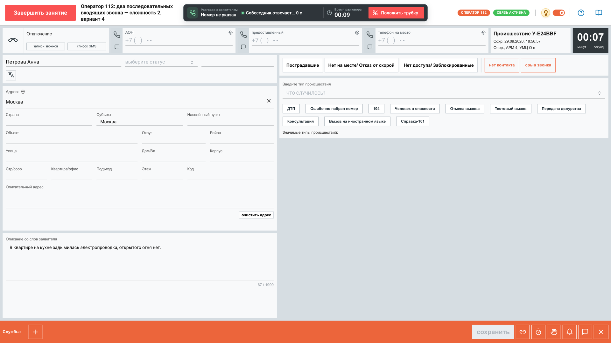

Рисунок 9 — АРМ-112: разговор с заявителем и заполнение карточки

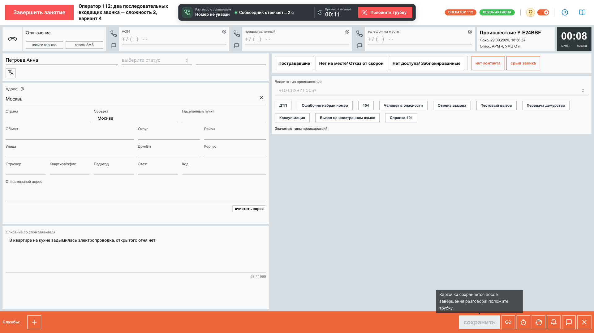

Рисунок 10 — Подсказка о незаполненных полях у кнопки сохранения

**Результаты.** В разделе «Мои результаты» доступны разборы завершённых попыток: балл, зачёт, время, число ошибок, комментарий преподавателя, сводка по нормативам, главные ошибки и рекомендации. Раздел «Справка» содержит памятку «Работа на АРМ-112»; она открывается и из АРМ, не прерывая попытку.

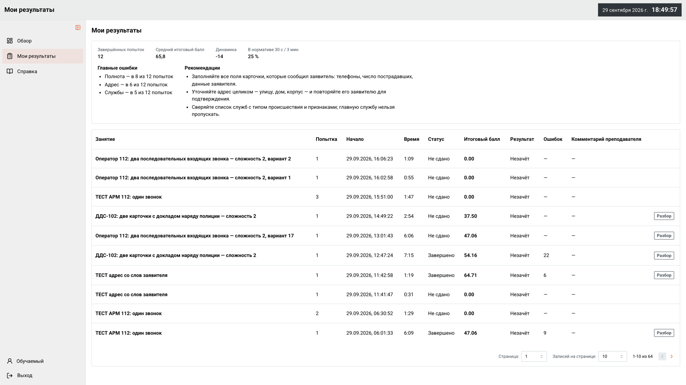

Рисунок 11 — «Мои результаты» обучаемого

### 10.3.3. Обучаемый на позиции диспетчера ДДС: реагирование

Занятие с позицией «диспетчер ДДС» начинается из «Обзора» так же, как занятие оператора 112. При старте открывается рабочее поле ДДС с журналом карточек службы.

1. Карточка поступает в журнал службы. Раскройте её в течение 30 с.
2. Изучите карточку: адрес, тип происшествия, сведения о пострадавших, службы, в которые она направлена.
3. Примите решение по компетенции своей службы: «Принята» или «Не принята». При отказе комментарий обязателен.
4. Ведите реагирование, меняя статус в строке статуса: выберите статус из доступных на текущем шаге, укажите номер наряда и комментарий. Первая запись со статусом и текстом — в течение 3 мин от появления карточки. Для «Отказ от выполнения работ» комментарий обязателен.
5. При необходимости позвоните руководителю бригады и доложите суть происшествия и адрес.
6. Доведите статус до «Работы завершены» или «Отказ от выполнения работ»: терминальный статус закрывает карточку.

Время до каждого статуса учитывается в аналитике преподавателя.

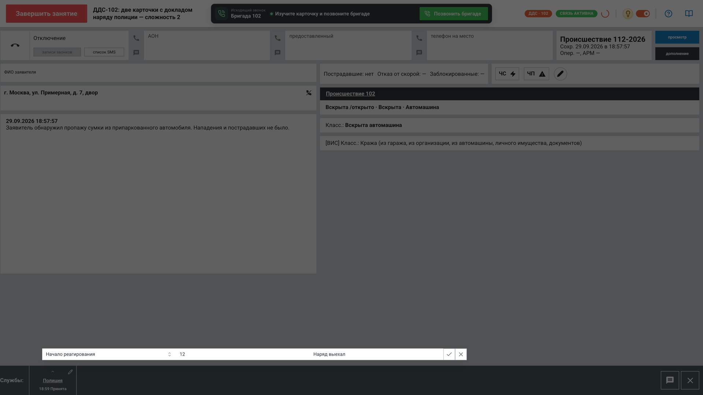

Рисунок 12 — АРМ ДДС: принятая карточка и строка статуса реагирования

### 10.3.4. Преподаватель: подготовка занятия

**Шаблоны и генерация с ИИ.**

1. В разделе «Шаблоны» запустите генерацию: нажмите «Сгенерировать шаблоны с ИИ», выберите основную службу и при необходимости дополнительные.
2. Генерация занимает от 10–15 с до нескольких минут. Страницу можно покинуть: при возвращении в том же браузере состояние генерации сохранится, а в «Шаблонах» будет видна плашка «Идёт генерация: N». Кнопки на экране ожидания: «Перейти к шаблонам» и «Новая генерация».
3. Готовый шаблон проверяйте по секциям. Каждую секцию нужно подтвердить, исправить или отклонить. Утвердить шаблон, пока не проверены все секции, нельзя.

Генерация ИИ — вспомогательный инструмент. Решение о том, попадёт ли шаблон в занятия, всегда принимает преподаватель.

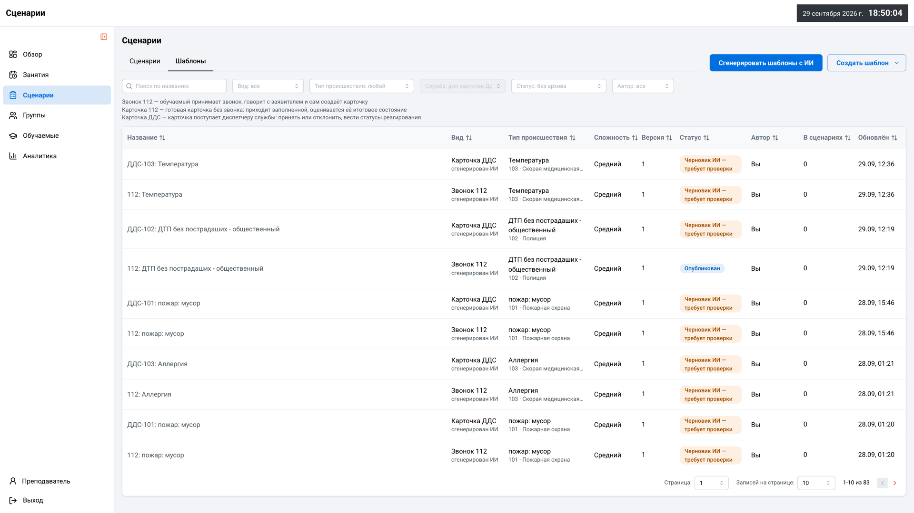

Рисунок 13 — Библиотека шаблонов со статусами

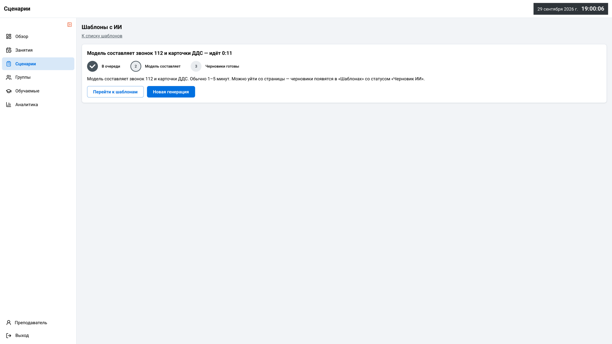

Рисунок 14 — Экран ожидания генерации шаблонов

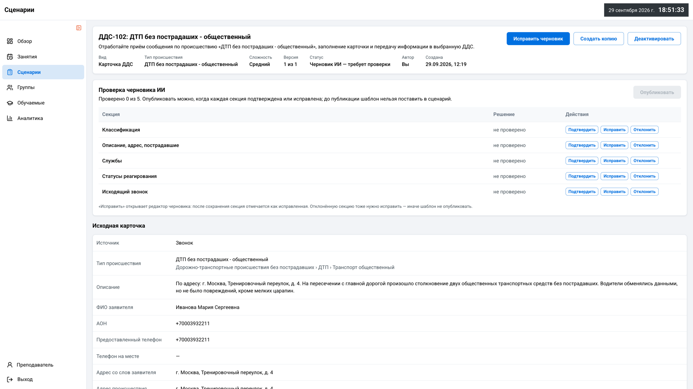

Рисунок 15 — Проверка черновика ИИ по секциям

**Сценарии.** В конструкторе сценария задайте название, сложность, состав из шаблонов звонков и карточек, условия подачи, позиции участников и порог зачёта. Сохраните черновик или нажмите «Сохранить и утвердить».

Процедурный сценарий собирается из категорий происшествий. Все 24 категории показаны со счётчиками доступных шаблонов: категории без шаблонов выделены серым, но выбрать их можно. Подсказка рядом со сложностью рекомендует число вызовов. Если шаблонов в категории не хватает, их можно сгенерировать сразу из конструктора.

Если при сохранении связь с сервером прервалась, повторно нажимать «Сохранить» не нужно: система сама проверит, записана ли правка, и покажет актуальное состояние.

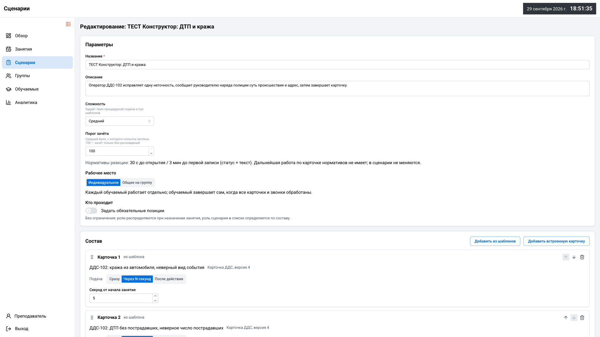

Рисунок 16 — Конструктор сценария

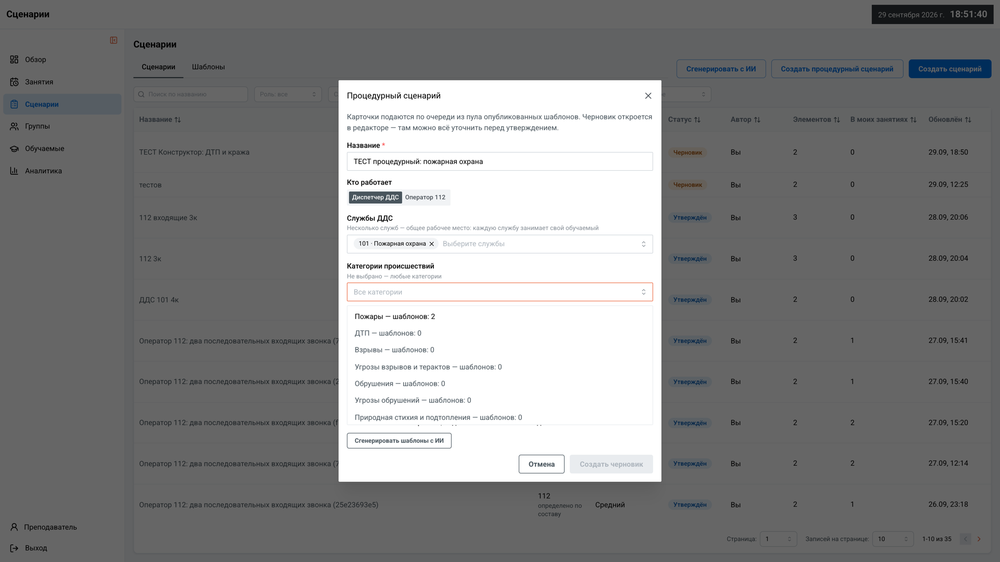

Рисунок 17 — Создание процедурного сценария по категориям происшествий

**Назначение.** Назначьте утверждённый сценарий группе или отдельным обучаемым, выберите позиции и укажите окно выполнения. Пока по занятию нет попыток, его можно перенести на другую дату или отменить.

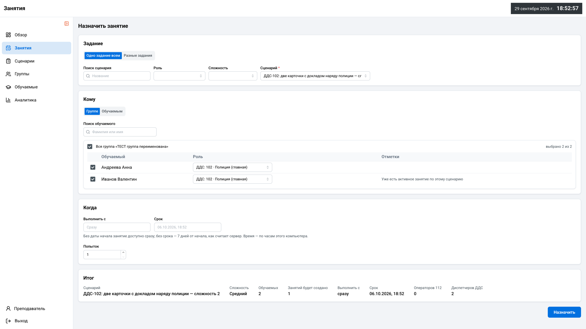

Рисунок 18 — Назначение занятия группе

### 10.3.5. Преподаватель: проведение занятия

**Монитор занятия.** Для каждого обучаемого показана плитка с текущим этапом и таймерами нормативов.

- Если норматив нарушен, плитка выделяется красной рамкой, а событие попадает в ленту тревог.
- Щелчок по плитке открывает подробности попытки.
- Режим проектора укрупняет плитки для показа всей аудитории.

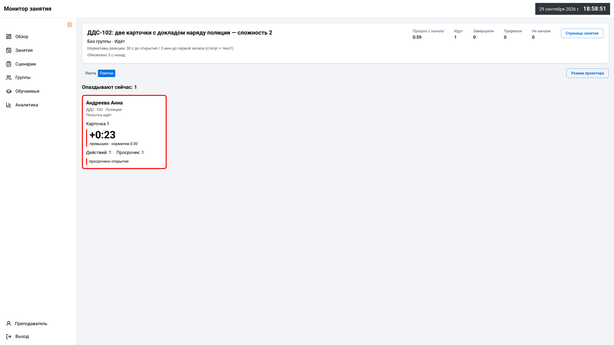

Рисунок 19 — Монитор занятия: плитки обучаемых и лента тревог

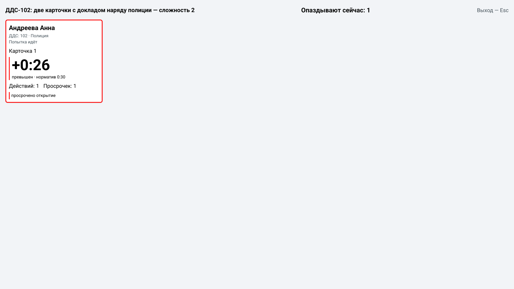

Рисунок 20 — Монитор занятия в режиме проектора

### 10.3.6. Преподаватель: проверка и разбор

**Очередь проверки.** Попытки, по которым нужно решение преподавателя, собраны в очередь «На проверке».

- Если оценка системы верна, нажмите «Верно — подтвердить».
- Кнопка «Следующая на проверке» переходит к следующей попытке.

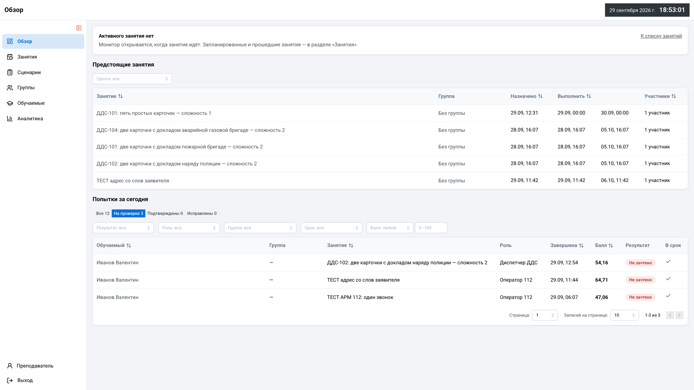

Рисунок 21 — Попытки за сегодня с фильтром «На проверке»

**Разбор попытки.** Экран разделён на две колонки, шкала времени проходит над обеими.

- **Левая колонка.** Блок «Проверьте оценку системы: подтвердите или исправьте»:
  - критерии по всей попытке;
  - расхождения, сгруппированные по карточкам;
  - классификация названиями;
  - проверка доклада по строкам: что сказал обучаемый, что должно было прозвучать, чего не хватает;
  - ошибки в адресах с посимвольной подсветкой.
- **Правая колонка.** Плеер записи звонка и диалог в виде реплик. Щелчок по реплике перематывает запись к этому месту. Если запись не собралась, показывается «Запись недоступна», диалог остаётся доступен.

Преподаватель подтверждает итоговую оценку системы или ставит свою с обязательной причиной. Экспертная оценка преподавателя — итоговая.

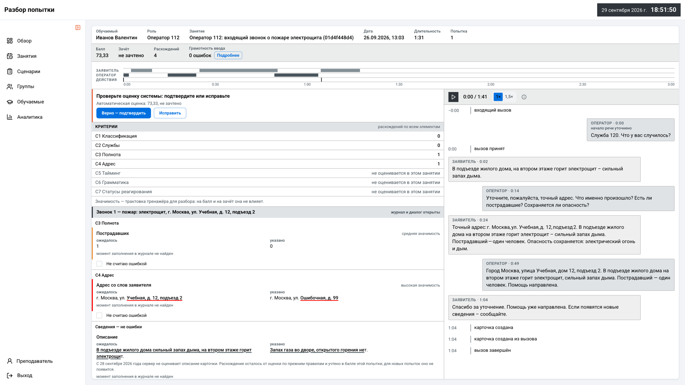

Рисунок 22 — Разбор попытки: критерии, расхождения и диалог

### 10.3.7. Преподаватель: аналитика и отчёты

Раздел «Аналитика» строится по выбранной группе и периоду. Под каждым блоком — короткий вывод.

- **Сводные плитки:** число попыток, средний балл, доля зачтённых, доля в нормативе, орфографические ошибки на попытку; показано изменение к прошлому периоду.
- **Тепловая карта:** какие группы проверок проседают у каждого обучаемого.
- **Успеваемость обучаемых:** готовность и рекомендуемая сложность следующего занятия для каждого.
- **Прогноз и «прогноз ↔ факт»:** прогноз результата и проверка его точности на фактических данных.
- **Ошибки в адресах** и **грамотность ввода**.
- **Какие службы забывают оповестить.**
- **Время по статусам ДДС.**
- **Сильные и слабые стороны группы:** у каждого обучаемого указаны сильная и слабая стороны.

Выгрузка: таблицы — в CSV, успеваемость и вся аналитика — через «Скачать PDF». Отчёт по занятию также выгружается в PDF и CSV.

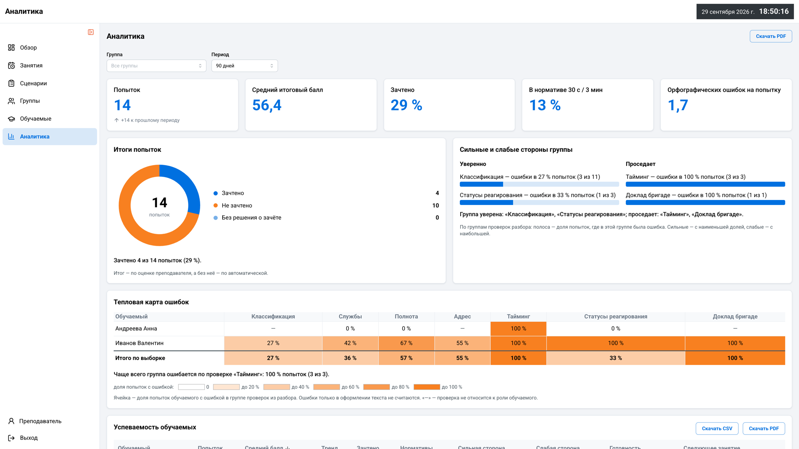

Рисунок 23 — «Аналитика»: сводные плитки и тепловая карта

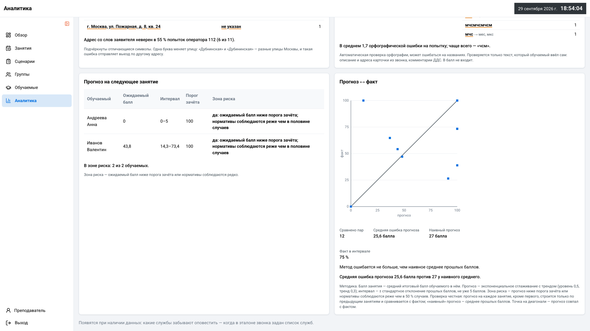

Рисунок 24 — «Аналитика»: прогноз на следующее занятие и проверка «прогноз ↔ факт»

### 10.3.8. Администратор

В панели администратора ведутся учётные записи пользователей: создание, смена роли, блокировка и разблокировка. Новому пользователю назначается одна из ролей: обучаемый, преподаватель или администратор. Позицию обучаемого (оператор 112 или диспетчер ДДС) преподаватель задаёт при назначении занятия, учебные группы тоже ведёт преподаватель.

Также в панели доступны:

- «Обзор» и «Мониторинг» — состояние компонентов, метрики, цели и алерты;
- «Отчёты» — использование, ошибки, нагрузка, доступность, действия пользователей;
- «Безопасность» — парольная политика и проверка целостности;
- «Сервисы», «Резервные копии», «Обновления» — состояние; управляющие действия отключены на сервере.

Учётной записи администратора в начальных данных стенда нет, поэтому снимков экрана панели в документе нет.

## 10.4. Сообщения пользователю

Таблица 49 — Сообщения пользователю

| Сообщение или ситуация | Причина | Действие |
|---|---|---|
| Кнопка сохранения карточки неактивна | Не заполнены обязательные поля | Навести курсор на кнопку и заполнить указанные поля |
| «Собеседник отвечает… N с» | Заявитель (ИИ) формулирует ответ | Дождаться ответа |
| Браузер запрашивает доступ к микрофону | Первый голосовой вызов | Разрешить доступ |
| «Запись недоступна» в разборе | Запись звонка не сохранилась на сервере | Проводить разбор по диалогу; сообщить администратору |
| Экран ожидания генерации | Генерация шаблонов ИИ ещё идёт | Дождаться или уйти со страницы: результат появится в «Шаблонах» |
| Блок аналитики сообщает, что сравнивать не с чем | Нет данных за период или не задан эталон | Выбрать другой период или дополнить эталон |
| «Сессия истекла или завершена на сервере. Войдите снова.» | Срок действия сессии закончился или она завершена на сервере | Войти повторно |
| «Сервис авторизации не отвечает» | Сервер входа временно недоступен | Нажать «Повторить»; если не помогло — «Войти заново» или обратиться к администратору |
| Переход в свой раздел вместо запрошенного | Раздел доступен другой роли | Работать в своём разделе или обратиться к администратору |
